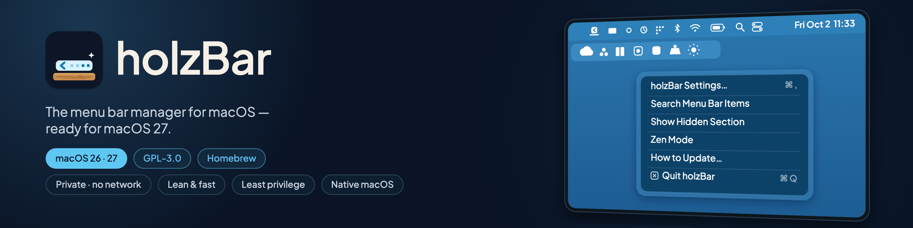
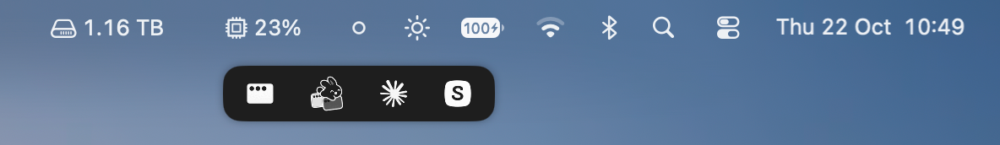
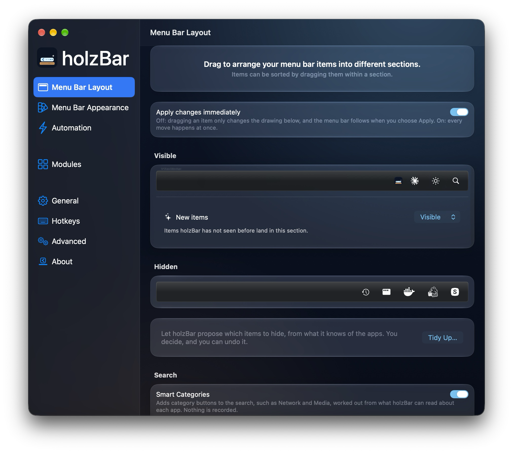
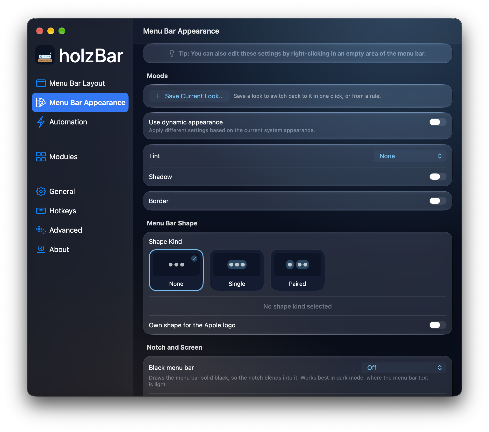
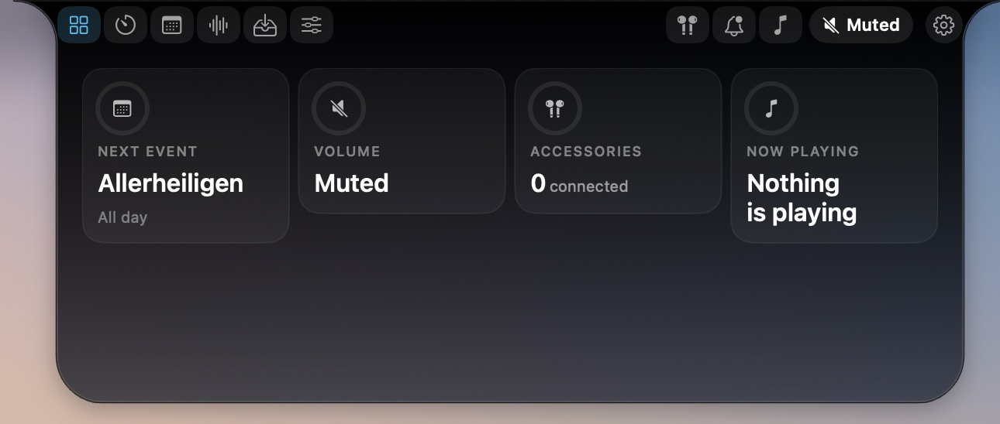
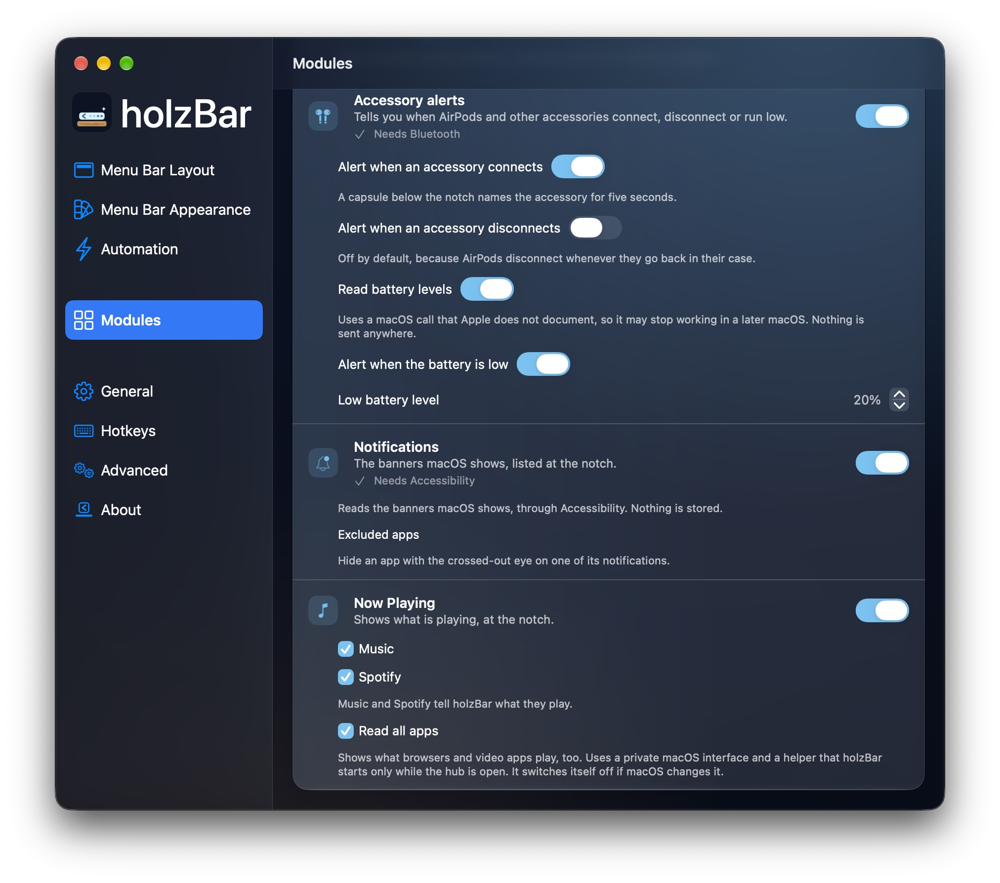

<div align="center">



<br>

[](https://github.com/holzcloud/holzBar/releases)
[](#install)
[](docs/macos27.md)
[](docs/privacy-and-permissions.md)
[](docs/signing.md)
[](LICENSE)

**holzBar** is a free, open source menu bar manager for macOS. It hides the icons you don't need,<br>
shows them again when you do, and works with the notch on macOS 26 and 27.

[Website](https://holzcloud.ch/holzbar) · [Install](#install) · [Features](docs/features.md) · [Comparison](#how-it-compares) · [Privacy](docs/privacy-and-permissions.md) · [Credits](#credits)

</div>

---

> [!IMPORTANT]
> ### holzBar is a fork of [Ice](https://github.com/jordanbaird/Ice) by [Jordan Baird](https://github.com/jordanbaird)
> Ice is one of the best menu bar managers ever made for the Mac, and nearly everything you see here is Jordan's work.
> holzBar keeps it going on macOS 27 while upstream development is slow. **If you enjoy holzBar, please star
> [Ice](https://github.com/jordanbaird/Ice) and consider [sponsoring Jordan](https://github.com/sponsors/jordanbaird).**
> holzBar is independent and not affiliated with or endorsed by the Ice project.

<p align="center"></p>

## Why holzBar

If you looked for an Ice fork that runs on macOS 27, or a free Bartender alternative that is open source, this is it.

- **Works on macOS 26 and 27.** A dedicated backend for the redesigned macOS 27 menu bar. Every pull request that changes code launches the app on both and runs the unit tests there. It needs macOS 14 or later; CI runs macOS 26 and 27.
- **Never online.** No update checks, telemetry or analytics, and a CI check proves the app contains no network code.
- **No dependencies, modern Swift.** Swift 6 language mode, built with Swift 6.4 and Xcode 27, no third-party packages.
- **Least privilege.** Accessibility at first launch, Screen Recording optional, for pictures of your items, Location Services only when you add a Wi-Fi-name condition to a rule, Bluetooth only when you add a Bluetooth condition or switch on the Accessory alerts module. Calendar access only when you switch on the Calendar module of the notch hub, and access to your Downloads folder only when you switch on its downloads source in the Live activities module (the camera and microphone source needs no permission). Since 0.0.7-beta2 no XPC service or helper app, and from 1.0.0 one signed library for the optional Read all apps of Now Playing, used only while the hub is open and that switch is on; from 1.0.0 holzBar carries one entitlement, `com.apple.security.personal-information.calendars`, which only lets macOS ask you for Calendar access, and no `get-task-allow`.
- **Verifiable releases.** Signed with holzBar's own certificate, with GitHub build provenance and, since 0.0.7-beta2, SLSA Build Level 3 provenance.
- **More than Ice.** Rules, scripts and widgets, profiles, folders, spacers, Zen mode, Shortcuts actions, URL commands, a command palette and moods, a black menu bar, and a camera and microphone dot on macOS 27. Available in 20 languages: English and nineteen translations, all machine-made and not yet checked by a native speaker ([how they are made and reviewed](docs/translations.md)).

<table>
<tr>
<td width="50%" valign="top"><b>Layout</b>: drag items into sections<br></td>
<td width="50%" valign="top"><b>Appearance</b>: moods, tint, border, shapes, a black bar<br></td>
</tr>
</table>

<table>
<tr>
<td width="50%" valign="top"><b>Notch hub, Overview — one tile per module</b><br></td>
<td width="50%" valign="top"><b>Modules — Accessory alerts, Notifications, Now Playing</b><br></td>
</tr>
</table>

More screenshots in the [gallery](docs/features.md#gallery), including the [notch hub and its modules](docs/features.md#notch-hub-and-modules).

## How it compares

Researched on 9 October 2026 from each project's own pages and repositories. A dash means the project does not state it.

| | Ice | Thaw | Bartender 7 | holzBar |
|---|:---:|:---:|:---:|:---:|
| Price, licence | free, GPL-3.0 | free, GPL-3.0 | paid, closed | free, GPL-3.0 |
| macOS 26 / 27 | dev builds / no | yes / yes | no (use Bartender 6) / yes | yes / yes |
| Hidden and always-hidden sections, separate bar | yes | yes | yes | yes |
| Layout profiles, groups, spacers | no | yes | yes | yes |
| Rules and scripts | no | yes | yes | yes |
| Network connections | Sparkle updates | Sparkle updates | vendor says none | none, enforced by CI |
| Dependencies, Swift | 5 packages, Swift 5 | 9 packages, Swift 6 | closed | none, Swift 6 |
| Build provenance | no | Cosign, SLSA | - | SLSA Build Level 3 |
| Developer ID, notarized | yes | yes | - | no (own certificate) |

Where holzBar loses: it has no Developer ID signature, a slide of the bar's own items on macOS 26 only, a small AppleScript dictionary, and one maintainer. The [full comparison](docs/comparison.md) covers 14 apps, with sources and the cells we could not verify.

## Install

Two Homebrew channels from the same tap. **Stable** (`holzbar`) is the newest plain release, currently 1.0.4. **Beta** (`holzbar@beta`) is the newest alpha, beta or plain release, whichever is newest.

```sh
brew tap holzcloud/holzbar https://github.com/holzcloud/holzBar
brew trust --cask holzcloud/holzbar/holzbar
brew install --cask holzcloud/holzbar/holzbar
```

For the beta, use `holzbar@beta` in the last two commands. Quit Ice, Thaw, Bartender or Hidden Bar first; your Ice settings are imported on the first launch. Update with `brew update && brew upgrade --cask holzbar`.

If macOS says holzBar "can't be opened", run `xattr -dr com.apple.quarantine /Applications/holzBar.app` and open it again. The release certificate has the SHA-256 `e55f0df15060b8c06c6842ccee85e6bc9f86cbbda3bd408abf991457840b1d95`; how to verify a download is in [docs/signing.md](docs/signing.md#for-users-verify-a-download). Switching channels, updating from 0.0.5 and building from source are in [Build and troubleshooting](docs/build-and-troubleshooting.md).

> [!WARNING]
> **macOS 27:** while holzBar hides menu bar items, Control Centre does not draw its camera, microphone and screen recording indicator. holzBar cannot prevent this, so it puts a dot on its own icon while the microphone (orange) or camera (green) is in use. [Details](docs/macos27.md#camera-and-microphone-indicator)

## What's new

### 1.0.5

Details: [full list](docs/features.md#new-in-105)

- **Command-drag across the holzBar icon**: on macOS 27, dragging an item with ⌘ Command across the holzBar icon hides its app (to the left) or shows it (to the right), with Undo in Menu Bar Layout.
- **Fixes**: rules no longer reveal hidden apps on macOS 27, rehiding waits for open menus, the ⌘ Command-drag respects the Touch ID lock and Zen mode, and the holzBar icon can no longer get lost in the hidden section.

### 1.0.4

Details: [release notes](docs/release-notes/v1.0.4.md) · [full list](docs/features.md#new-in-104)

- **Order inside sections**: on macOS 26 and earlier, items keep their order inside each section and go back to their place when they reappear.
- **Safer URL commands**: while Zen mode is on, `holzbar://application-menus/toggle` is ignored, and a burst of commands from another app is limited.
- **Fixes**: no moves while the menu bar settles after a display change, slow-starting apps such as OneDrive are placed once they run, items with a live value in their title keep their place, and Wine or CrossOver tray icons are left alone.

### Earlier releases

- **1.0.3** ([notes](docs/release-notes/v1.0.3.md)): apps already running at launch appear in the Shelf, no "Unable to display menu bar items" while pictures are taken, and a tile no longer shows another app's icon.
- **1.0.2** ([notes](docs/release-notes/v1.0.2.md)): a more compact What's New window, a smaller permissions window, and a click on the holzBar icon no longer opens another item's menu, such as Wi-Fi.
- **1.0.1** ([notes](docs/release-notes/v1.0.1.md), [details](docs/features.md#new-in-101)): the What's New window, a tab for every version, with a switch under Settings → General → Startup.
- **1.0.0** ([notes](docs/release-notes/v1.0.0.md), [details](docs/features.md#new-in-100)):
  - Notch hub: eight optional modules (Now Playing, Calendar, Timers, Live activities, File drop, Display controls, Accessory alerts, Notifications), each off until you switch it on in Settings → Modules.
  - Menu bar and Shelf: a count badge on the icon, sorting in Menu Bar Layout and drop to hide on macOS 27, Apple Items in the Shelf, hidden items that stay listed, hub tabs in one row.
  - 20 languages: nine new translations, all machine-made ([how they are reviewed](docs/translations.md)).
- **0.0.13** ([notes](docs/release-notes/v0.0.13.md), [details](docs/features.md#new-in-0013)):
  - Shelf: type to find an item, a fold tile for always-hidden items ("+3"), dimmed apps that are not running, drag to reorder.
  - Built-in items and app launchers in the Widgets module: Focus, AirDrop, media controls, fast user switching, a timer.
  - Layout editor draws first and applies in one pass; animation and icon styles as picture cards.
  - Per-display behaviour, short names in the search (`bt`, `wlan`, `dnd`) and 11 languages.
- **0.0.12** ([notes](docs/release-notes/v0.0.12.md), [details](docs/features.md#new-in-0012)): Apple Items, the notch hub, Smart Categories in the search, a floating Shelf and a glass command palette.
- **0.0.11** ([notes](docs/release-notes/v0.0.11.md), [details](docs/features.md#new-in-0011)): the bar's items slide in and out on macOS 26, a new glass look for Search and Hints, shared design tokens.
- **0.0.9** ([notes](docs/release-notes/v0.0.9.md), [details](docs/features.md#new-in-009)): a Modules pane, a command palette, an AppleScript dictionary, moods, grid and column layouts for the Shelf, sound and Bluetooth conditions for rules, usage suggestions.
- **0.0.8** ([notes](docs/release-notes/v0.0.8.md), [details](docs/features.md#new-in-008)): rules, scripts, widgets, layout snapshots, a Touch ID lock, menu bar styles, dragging without ⌘ and macOS 27's overflow button.

**Planned, not available yet:** more modules for the notch hub. Every later module is optional, off until you switch it on, and never uses the network. The [roadmap](docs/features.md#planned-next) has the details.

## More

[Features and gallery](docs/features.md) · [macOS 27 notes](docs/macos27.md) · [Privacy and permissions](docs/privacy-and-permissions.md) · [Troubleshooting](docs/build-and-troubleshooting.md) · [Full comparison](docs/comparison.md) · [Notes on the comparison](docs/alternatives.md)

## Credits

- [**Ice**](https://github.com/jordanbaird/Ice) by [Jordan Baird](https://github.com/jordanbaird): the app holzBar is built on, with its design, its features and almost all of its code. Thank you, Jordan! If you like it, [sponsor Jordan](https://github.com/sponsors/jordanbaird) or [buy him a coffee](https://www.buymeacoffee.com/jordanbaird).
- [**RabenkoYevhenii**](https://github.com/RabenkoYevhenii): the macOS 27 backend ([jordanbaird/Ice#995](https://github.com/jordanbaird/Ice/pull/995)).
- [**Barometer**](https://github.com/mackid1993/Barometer) by [mackid1993](https://github.com/mackid1993) and [**Thaw**](https://github.com/thaw-app/Thaw) by [thaw-app](https://github.com/thaw-app): the macOS 27 assertion code holzBar's hiding is adapted from.

holzBar links no third-party package. The adapted projects and their licenses are listed in the app under **Settings → About → Acknowledgements**.

## License

holzBar is available under the [GPL-3.0 license](LICENSE), like Ice. See [NOTICE](NOTICE) for attribution and a summary of the changes made in this fork. Like holzBar? [Sponsor holzcloud](https://github.com/sponsors/holzcloud).
