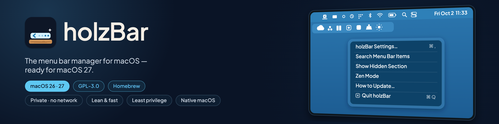

<div align="center">



<br>

[](https://github.com/holzcloud/holzBar/releases)
[](#install)
[](docs/macos27.md)
[](docs/privacy-and-permissions.md)
[](docs/signing.md)
[](LICENSE)

**holzBar** is a free, open source menu bar manager for macOS. It hides the icons you don't need,<br>
shows them again when you do, and works with the notch on macOS 26 and 27.

[Website](https://holzcloud.ch/holzbar) · [Install](#install) · [Features](docs/features.md) · [Comparison](#how-it-compares) · [Privacy](docs/privacy-and-permissions.md) · [Credits](#credits)

</div>

---

> [!IMPORTANT]
> ### holzBar is a fork of [Ice](https://github.com/jordanbaird/Ice) by [Jordan Baird](https://github.com/jordanbaird)
> Ice is one of the best menu bar managers ever made for the Mac, and nearly everything you see here is Jordan's work.
> holzBar keeps it going on macOS 27 while upstream development is slow. **If you enjoy holzBar, please star
> [Ice](https://github.com/jordanbaird/Ice) and consider [sponsoring Jordan](https://github.com/sponsors/jordanbaird).**
> holzBar is independent and not affiliated with or endorsed by the Ice project.

<p align="center"></p>

## Why holzBar

If you looked for an Ice fork that runs on macOS 27, or a free Bartender alternative that is open source, this is it.

- **Works on macOS 26 and 27.** A dedicated backend for the redesigned macOS 27 menu bar. Every pull request that changes code launches the app on both and runs the unit tests there. It needs macOS 14 or later; older versions are not tested.
- **Never online.** No update checks, telemetry or analytics, and a CI check proves the app contains no network code.
- **No dependencies, modern Swift.** Swift 6 language mode, built with Swift 6.4 and Xcode 27, no third-party packages.
- **Least privilege.** Accessibility at first launch, Screen Recording optional, for pictures of your items, Location Services only when you add a Wi-Fi-name condition to a rule, Bluetooth only when you add a Bluetooth condition. Since 0.0.7-beta2: one executable, no helper process, no entitlements.
- **Verifiable releases.** Signed with holzBar's own certificate, with GitHub build provenance and, since 0.0.7-beta2, SLSA Build Level 3 provenance.
- **More than Ice.** Rules, scripts and widgets, profiles, folders, spacers, Zen mode, Shortcuts actions, URL commands, a command palette and moods (both Preview), a black menu bar, and a camera and microphone dot on macOS 27. Available in English, German, French, Italian and Romansh.

<table>
<tr>
<td width="50%" valign="top"><b>Layout</b>: drag items into sections<br></td>
<td width="50%" valign="top"><b>Appearance</b>: moods, tint, border, shapes, a black bar<br></td>
</tr>
</table>

More screenshots in the [gallery](docs/features.md#gallery).

## How it compares

Researched on 9 October 2026 from each project's own pages and repositories. A dash means the project does not state it.

| | Ice | Thaw | Bartender 7 | holzBar |
|---|:---:|:---:|:---:|:---:|
| Price, licence | free, GPL-3.0 | free, GPL-3.0 | paid, closed | free, GPL-3.0 |
| macOS 26 / 27 | dev builds / no | yes / yes | no (use Bartender 6) / yes | yes / yes |
| Hidden and always-hidden sections, separate bar | yes | yes | yes | yes |
| Layout profiles, groups, spacers | no | yes | yes | yes |
| Rules and scripts | no | yes | yes | yes |
| Network connections | Sparkle updates | Sparkle updates | vendor says none | none, enforced by CI |
| Dependencies, Swift | 5 packages, Swift 5 | 9 packages, Swift 6 | closed | none, Swift 6 |
| Build provenance | no | Cosign, SLSA | - | SLSA Build Level 3 |
| Developer ID, notarized | yes | yes | - | no (own certificate) |

Where holzBar loses: it has no Developer ID signature, fewer languages than Thaw, only a Preview slide of the bar's own items (macOS 26), a small AppleScript dictionary (Preview), and one maintainer. The [full comparison](docs/comparison.md) covers 14 apps, with sources and the cells we could not verify.

## Install

Two Homebrew channels from the same tap. **Stable** (`holzbar`) is the newest plain release, currently 0.0.10. **Beta** (`holzbar@beta`) is the newest alpha, beta or plain release, whichever is newest.

```sh
brew tap holzcloud/holzbar https://github.com/holzcloud/holzBar
brew trust --cask holzcloud/holzbar/holzbar
brew install --cask holzcloud/holzbar/holzbar
```

For the beta, use `holzbar@beta` in the last two commands. Quit Ice, Thaw, Bartender or Hidden Bar first; your Ice settings are imported on the first launch. Update with `brew update && brew upgrade --cask holzbar`.

If macOS says holzBar "can't be opened", run `xattr -dr com.apple.quarantine /Applications/holzBar.app` and open it again. The release certificate has the SHA-256 `e55f0df15060b8c06c6842ccee85e6bc9f86cbbda3bd408abf991457840b1d95`; how to verify a download is in [docs/signing.md](docs/signing.md#for-users-verify-a-download). Switching channels, updating from 0.0.5 and building from source are in [Build and troubleshooting](docs/build-and-troubleshooting.md).

> [!WARNING]
> **macOS 27:** while holzBar hides menu bar items, Control Centre does not draw its camera, microphone and screen recording indicator. holzBar cannot prevent this, so it puts a dot on its own icon while the microphone (orange) or camera (green) is in use. [Details](docs/macos27.md#camera-and-microphone-indicator)

## What's next

**0.0.10 is out** (see the [release notes](docs/release-notes/v0.0.10.md)): a bugfix release that ends a crash when an app launched or quit on macOS 26.

**0.0.9** (see the [release notes](docs/release-notes/v0.0.9.md) and [what is new](docs/features.md#new-in-009)): a new Settings window with a Modules pane, a command palette, an AppleScript dictionary, moods (saved looks), grid and column layouts and a fade for the holzBar Shelf, sound output and Bluetooth conditions for rules, opt-in usage suggestions, and a hint when a rule puts an item back. Most of it is a **Preview**: built and unit tested, not yet tested on a Mac. Report what does not work.

**0.0.8** (see the [release notes](docs/release-notes/v0.0.8.md) and [what is new](docs/features.md#new-in-008)) brought rules, scripts, per-item conditions, widgets, layout snapshots, a Touch ID lock, menu bar styles, dragging items without ⌘ and support for macOS 27's own overflow button.

**Next release (Preview):** the bar's hidden items slide in and out on macOS 26, under **Animate showing and hiding** in Settings → General (never with Reduce Motion on; macOS 27 animates its own bar, macOS 14 and 15 keep the instant change), and on macOS 27 the **Apple Items** module: hide the clock, Control Center, Wi-Fi or the battery, and replacement icons that open an Apple item. **Smart Categories** add category buttons to the search (System, Network, Media and more), worked out from what holzBar can read about each app; nothing is recorded. The holzBar Shelf can also **float**: under **Style** in Settings → General it becomes a bar of its own a little below the menu bar, and under **Location** it opens at the holzBar icon, at the right edge of the screen or below the mouse pointer. The **notch hub**, a panel at the notch for optional modules, is built as a **Preview** with no module in it yet ([what it does](docs/features.md#in-the-next-release)). **Planned, not available yet:** settings sync and the modules of the notch hub in 1.0.0. Every later module is optional, off until you switch it on, and never uses the network. The [roadmap](docs/features.md#planned-next) has the details.

## More

[Features and gallery](docs/features.md) · [macOS 27 notes](docs/macos27.md) · [Privacy and permissions](docs/privacy-and-permissions.md) · [Troubleshooting](docs/build-and-troubleshooting.md) · [Full comparison](docs/comparison.md) · [Notes on the comparison](docs/alternatives.md)

## Credits

- [**Ice**](https://github.com/jordanbaird/Ice) by [Jordan Baird](https://github.com/jordanbaird): the app holzBar is built on, with its design, its features and almost all of its code. Thank you, Jordan! If you like it, [sponsor Jordan](https://github.com/sponsors/jordanbaird) or [buy him a coffee](https://www.buymeacoffee.com/jordanbaird).
- [**RabenkoYevhenii**](https://github.com/RabenkoYevhenii): the macOS 27 backend ([jordanbaird/Ice#995](https://github.com/jordanbaird/Ice/pull/995)).
- [**Barometer**](https://github.com/mackid1993/Barometer) by [mackid1993](https://github.com/mackid1993) and [**Thaw**](https://github.com/thaw-app/Thaw) by [thaw-app](https://github.com/thaw-app): the macOS 27 assertion code holzBar's hiding is adapted from.

holzBar links no third-party package. The adapted projects and their licenses are listed in the app under **Settings → About → Acknowledgements**.

## License

holzBar is available under the [GPL-3.0 license](LICENSE), like Ice. See [NOTICE](NOTICE) for attribution and a summary of the changes made in this fork. Like holzBar? [Sponsor holzcloud](https://github.com/sponsors/holzcloud).
