# Features

<table>
<tr>
<td valign="top" width="50%">

#### Menu bar items
- ✅ Hide items in a hidden and an always-hidden section
- ✅ Show on hover, click or scroll (trackpad **and mouse wheel**)
- ✅ Automatic rehide
- ✅ Drag-and-drop layout editor — as bars or as a list of every item with a filter; it draws first and lays the bar out in one pass when you choose Apply (or at once, if you prefer)
- ✅ **Drag items in the menu bar without ⌘ Command** (macOS 26 and 27) — an optional module in Settings, Modules, off until you switch it on
- ✅ **Apple Items** (macOS 27) — hide the clock, Control Center, Wi-Fi or the battery, and keep an Apple item one click away with a replacement icon; an optional module, off until you switch it on
- ✅ **Notch hub** — one black shape that grows out of the notch, for optional modules, each a round button in one row; live activities widen the notch; off until you switch it on; Timers, Calendar, Live activities, File drop, Display controls, Accessory alerts, Indicators, Notifications and Now Playing are its first modules
- ✅ **Dock badges** — the unread counts of the apps in your Dock as menu bar items, alone or in groups; an optional module, off until you switch it on; uses the Accessibility access holzBar already has, and the count is read through a private interface behind its own switch
- ✅ **System monitor** — **System readouts** (CPU, GPU, memory, network, disk and battery tiles in the Notch hub and as menu bar widgets) and **System alerts** (an alert in the notch when the Mac crosses a limit you set); two optional modules, off until you switch them on, no permission needed
- ✅ **Layout profiles** — "Work", "Home", … one click, hotkey or URL away
- ✅ **Profiles bound to a display or a Space** — applied when you connect the display or switch to the Space
- ✅ **Groups** (folders) — several items behind an icon of their own, in a colour and with a symbol or image of your choice
- ✅ **Item images of your choice** — give any item its own picture, or its app's icon; without Screen Recording, the holzBar Shelf and the search show app icons
- ✅ **Spacers** — empty items of adjustable width
- ✅ **Choose where new items appear** — a tile in the Layout pane shows where, and you can change it there
- ✅ **Per display: always show everything, or collapse** — the display under the pointer decides
- ✅ **Animation styles** — Instant, Smooth or Fade, as picture cards
- ✅ **Keeps items in their section after app updates, title changes and display changes**
- ✅ Search menu bar items — by abbreviation ("cc" for Control Centre), by short name ("bt" for Bluetooth), despite typos, and with what you open from it first
- ✅ **Open an item by letter** — a hotkey shows a letter under every item; type it to open the item's menu
- ✅ **Keyboard and VoiceOver** — arrange items in the Layout pane with the arrow keys or the list's section menus, move items with VoiceOver actions
- ✅ **Undo after every layout change** — a notice with Undo for five seconds, ⌘Z and ⇧⌘Z in Settings and an Undo button in Layout, also for changes made in the menu bar
- ✅ **Opened items stay** up to 30 s after their menu closes — or open without showing the item at all
- ✅ **Show When It Changes** — a marked item shows for 5 s when its title or value changes
- ✅ **Privacy indicators stay visible** — the camera and microphone indicator, the FaceTime item and the Screenshot tool's recording button can be moved, never hidden macOS 14 to 26
- ✅ Item spacing BETA macOS 14 to 26; not offered on macOS 27

</td>
<td valign="top" width="50%">

#### holzBar Shelf
- ✅ Hidden items in a bar below the menu bar
- ✅ **Only on the built-in display or on displays with a notch** — the other displays keep every item shown in the menu bar
- ✅ **Shows items the notch covers**
- ✅ **Works from the keyboard** — open it with its hotkey, then the arrow keys, Return and Escape
- ✅ **Row, grid or column** — and it fades in, never with Reduce Motion on
- ✅ **Type to find an item** — the best match is highlighted, Return opens its menu
- ✅ **Always-hidden items behind a fold** — one tile, "+3", opens them
- ✅ **Closed apps, dimmed** — a click launches the app off by default
- ✅ **Rearrange by dragging** — in order, into another section, or up onto the menu bar

#### Appearance
- ✅ Tint, shadow, border; Single and Paired shapes with round or square ends
- ✅ **Black menu bar that hides the notch**
- ✅ **Rounded screen corners**
- ✅ **Dashed and dotted borders**
- ✅ **Tints from the wallpaper or the accent colour, and the system's glass** glass on macOS 26 and later
- ✅ **Moods** — save the look of the menu bar under a name and switch to it in one click, from the palette or with a rule
- ✅ **Menu bar styles**: a **Sections** shape, one shape per section on the bar (macOS 14 to 26; macOS 27 draws Paired), a **shape of its own for the Apple logo** (bar tint, accent colour, wallpaper or a colour), **outlines** in the accent colour or a gradient, **vertical gradients**, one gradient per shape and the **tint strength**

</td>
</tr>
<tr>
<td valign="top" width="50%">

#### Automation
- ✅ **Rules, scripts, profile hooks and widgets** — see [New in 0.0.8](#new-in-008)
- ✅ **Command palette** — a Spotlight-like panel for actions, profiles, moods, rules and items
- ✅ **AppleScript dictionary** — show, hide, apply a profile, switch rules and Zen mode; lasting changes ask first
- ✅ **Sound output and Bluetooth as rule conditions**
- ✅ **Show hidden items when the battery is low or the network drops** — since 0.0.8 these are rules in the Automation pane (the old settings are moved there once)
- ✅ **Zen mode** — one hotkey, menu item, URL or Shortcuts action keeps hidden items hidden; optionally on while the screen is mirrored or shared, without any permission
- ✅ **Shortcuts actions** — Zen mode, show or hide a section, apply a profile, open an item by name, search; while Zen mode is on they follow the same rules as a URL command (nothing is revealed, turning Zen mode off asks first and is refused while the screen is shared)
- ✅ **`holzbar://` URL commands** and [Raycast script commands](../Integrations/Raycast)
- ✅ Hotkeys for sections, search, the holzBar Shelf, app menus, **auto-rehide**, **a quick peek**, **Zen mode**, **each layout profile** and **each menu bar item** — a combination another holzBar hotkey already uses moves only when you choose **Replace**

</td>
<td valign="top" width="50%">

#### Settings
- ✅ **Export and import** all settings
- ✅ **Imports your Ice settings** on first launch, and Thaw's or Hidden Bar's through Settings → Advanced
- ✅ **Alerts in Settings are sheets** on its window, so holzBar keeps working while one is open
- ✅ **Eleven panes sorted by task** — Layout, Showing & Hiding, holzBar Shelf, Profiles & History, Appearance, Automation, Modules, General, Hotkeys, Advanced and About, with compact rows and an info button for each
- ✅ **Search over every setting** — ⌘F in the Settings window
- ✅ **A Modules pane** for the optional modules, each off until you switch it on
- ✅ **A short introduction** after the first launch, three steps, again from Settings → About
- ✅ **Usage suggestions** off by default — local counters, **View Data…** and **Forget everything…**, in Layout
- ✅ Launch at login
- ✅ **What's New window** — a tab for every version since 1.0.0; opens once after an update and from Settings → About, with a switch under General → Startup — see [New in 1.0.1](#new-in-101)
- ✅ **20 languages**: English and nineteen translations (German, French, Italian, Romansh, Spanish, Brazilian Portuguese, Dutch, Polish, Czech, Hungarian, Swedish, Turkish, Indonesian, Russian, Ukrainian, Japanese, Korean, Simplified and Traditional Chinese), all machine-made and not yet checked by a native speaker, see [Translations](translations.md) — holzBar follows your Mac's language; choose another one for holzBar alone in System Settings → General → Language & Region → Applications

</td>
</tr>
</table>

## New in 1.2.0

1.2.0 is in beta; see the [release notes of 1.2.0 beta 1](release-notes/v1.2.0-beta1.md).

- **System readouts** (Settings → Modules → System monitor, an optional module that is off until you switch it on, needs no permission and measures nothing while it is off or while nothing it feeds is shown): tiles for the CPU, GPU, memory, network, disk and battery in the Notch hub's Overview and in a tab of their own.
  - **CPU** shows the load, the thermal state when the Mac runs warm (the **Thermal state** switch) and, on Apple silicon, the load of the performance and the efficiency cores (**P 42 % · E 12 %**). **GPU** shows how busy the graphics processor is; it appears only while **Read GPU load** is on. **Memory** shows the used share with one line under it: the memory pressure while it is not normal, otherwise the swap in use, otherwise the capacity. **Network** shows the download and upload speed. **Disk** shows the free space and the capacity (the read and write speed is the Disk Activity widget). **Battery** (on a Mac with a battery) shows the charge with the time left or until full and the power adapter's watts.
  - **Curves**: the CPU, GPU, memory and network tiles draw the last two minutes as a quiet curve. The curve lives in memory only and is gone when holzBar quits; with Increase Contrast it is drawn brighter and without the area.
  - **Settings**: a switch for every tile, **Thermal state**, **Refresh tiles every** (a choice of seconds) and **Network speed unit** (bytes or bits per second, which also changes the Network Speed widget).
  - **Read GPU load** is an optional switch, off by default and kept on this Mac only. It reads one statistic of the graphics driver through a private macOS interface that Apple does not document and that can stop working; holzBar switches it off by itself, and says so, if macOS changes it.
- **System alerts** (Settings → Modules → System monitor, an optional module that is off until you switch it on, needs no permission and measures nothing while it is off or while no rule is on): alerts in the notch when the Mac crosses a limit you set. Five rules, each with its own switch, limit and **Held for** time:
  - **CPU load** (on by default; above 90 percent for 5 minutes; 50 to 95 percent in steps of 5), **Memory pressure** (off; Warning, held for 1 minute; or Critical), **Thermal state** (on; Serious, with no wait; or Fair or Critical), **Free disk space** (on; below 10 GB for 1 minute; 5, 10, 20, 50, 100 or 200 GB) and **Mac battery** (on; below 20 percent, only on battery, with no wait; 5 to 50 percent; shown only on a Mac with a battery). **Held for** is Immediately, 10 or 30 seconds, 1, 5 or 15 minutes.
  - **How an alert shows**: the notch widens for about 30 seconds with the rule's symbol and value, amber near the limit and red well past it, and the alert stays as a pill beside the notch and in the **Live activities** list while the hub is open. It works without the Notch hub (at the top centre of the menu bar on a display without a notch, below the notch where the bar is too full to widen it). When the condition clears, the notch says "Normal" for a moment and the alert leaves.
  - **No flapping**: an alert fires only after the condition has held for the time you set, clears only after the value has moved back past the limit by a margin and stayed there for 30 seconds, repeats at most every 30 minutes for the same rule, and at most four alerts fire in an hour. Nothing fires in the 30 seconds after the Mac wakes, the screen unlocks or a display changes, or after you switch a rule on.
  - **Test alert** shows a sample alert for five seconds; with System notifications on and allowed it also sends one sample notification, which is removed again, and it never asks for the permission.
  - **System notifications** is an optional switch, off by default and kept on this Mac only. When you switch it on, macOS asks once for the Notifications permission (the alert option only, no sound and no badge); then every alert that fires is also a notification, one per rule, removed when the alert clears or when you switch the option off. The notification holds the rule's name and value, nothing else. If macOS refuses, the module says "Notifications are off for holzBar" with a button to System Settings, and the alerts in the notch go on.
- **Devices** (Settings → Modules → Notch → Accessory alerts, and the hub's **Accessories** tab): one row per device name, with a symbol, the battery level when macOS reports one (the lowest part for AirPods), connected devices first and paired devices that are not connected in grey. The Settings list shows how many are connected and needs no permission of its own: it reads the paired devices only when Bluetooth is already allowed, and Settings never asks for it. Battery levels use the **Read battery levels** switch of Accessory alerts, with the module and the Notch hub off as well.
- **Lowest Device Battery** (Settings → Modules → Widgets): a widget source that shows the symbol of the device kind and the lowest battery level of your connected accessories, such as AirPods, a keyboard or a mouse. The name of the device is only in the tooltip and for VoiceOver. It is offered while **Read battery levels** is on, works without the Notch hub and without Accessory alerts, and shows an en dash when no device reports a level. It refreshes when macOS reports a power-source change and every five minutes while the widget is visible.
- **New widget readouts** (Settings → Modules → Widgets): sources **Network Speed** (Download, Upload, or both), **Disk Activity** (Read, Write, or both), **GPU Load** (Percent; offered only while Read GPU load is on) and **Thermal State** (a word such as Nominal or Serious); new formats for the old sources: CPU Load **Per Core Cluster**, Memory **Pressure** and **Swap Used**, Battery **Percent and Time Left** and **Adapter Watts**. Every widget keeps one fixed width, so the text never moves the items beside it, and a value that cannot be read shows an en dash. A source refreshes only while its widget is visible.
- **Energy**: every readout runs from one shared schedule that sleeps while nothing is shown, while the Mac is asleep or locked, and slows down in Low Power Mode; it never polls while the hub is closed and no readout widget is visible.
- **Indicators** (Settings → Modules → Notch, an optional module that is off until you switch it on, needs no permission until you switch on Replace the system display, and costs nothing while it is off or while the hub is closed and every switch is off): short flashes in the closed notch, for the time you choose, over the part of the menu bar beside it that is free. On a bar with no room beside the notch a flash hangs just below it instead, at the same width. A flash does not show while the hub is open, and VoiceOver is told once per burst.
  - **Input source**: switching the keyboard layout or input method flashes its icon and its short code (the name too where there is room). **Show for** is 0.5, 1, 1.5, 2 or 3 seconds (1.5 by default). Nothing shows while only one input source is enabled, and the module says so. holzBar learns of a switch from a system notification; it never polls.
  - **Volume and brightness**: a change of the default sound output's volume, the mute, or reaching either end of the range flashes the speaker and the level the output reports (or **Muted**), at a fixed width. The brightness keys flash the display's brightness the same way (see below). A change smaller than one sixty-fourth of the range never flashes. macOS still shows its own display unless you replace it.
  - **Replace the system display** (a sub row of Volume and brightness; off by default and kept on this Mac only): holzBar takes the volume up, volume down and mute keys and the brightness keys it can handle, and shows its own flash instead of macOS's display. It is the only place holzBar asks for **Accessibility** for this module; the switch is labelled as using a private interface. A volume key moves the default output by one sixteenth of the range (one sixty-fourth with ⌥ Option and ⇧ Shift held) and shows the level the output reads back. The brightness keys change the built-in display only while Display controls and its **Brightness** switch are on, and an external monitor only while Display controls and its **External monitors (DDC)** switch are on, through the two macOS interfaces that Apple does not document and that Display controls already uses; they never go below 2 percent and never write to a monitor that cannot be told apart from another. A key holzBar cannot handle reaches macOS unchanged: a full-screen app, a menu bar hidden by the system, a mirrored or shared screen, an output without a volume control, a monitor that does not answer DDC, the first three seconds after a wake, a key held with any modifier except ⌥ Option and ⇧ Shift together, and every other key. If the situation changes in the instant between a press and its handling (an output unplugged at that moment), that one press does nothing and the next one passes. If macOS takes the access away holzBar lets go of the keys at once, and if the private interface changes it switches itself off for the session and says so. Copy Diagnostics has an **Indicators** line with counts and fixed words only.
- **Gestures** (Settings → Modules → Notch → Notch hub, off by default): a downward scroll over the closed notch opens the hub and an upward one closes it; a sideways swipe skips a track through Now Playing and flashes **Next** or **Previous** for a second. One action per swipe, with a trackpad (natural scrolling on or off) and with a mouse wheel; a scroll that began outside the notch's area never acts. The scroll monitor listens only, needs no permission and exists only while the hub and the switch are on.
- **Follow the pointer** (**Show the hub on** in the Notch hub's settings): the hub opens on the display where the pointer is, with the hotkey, an alert click or an indicator; with the pointer on no display that has the hub, on the display of the key window (All displays opens on the first display then).
- **Pin the hub**: a pin button at the left end of the line under the notch (**Pin the hub** and **Unpin the hub**). A pinned hub stays open when the pointer leaves it and on a click outside, and says "Pinned by you". Esc (for a hub opened with its hotkey, the only opening that takes the keyboard), the hotkey, a change of Space or display, a gesture and Settings still close it, and closing unpins it.
- **Bounce** (Notch hub's settings, on by default): off, the hub opens, resizes and closes with a plain 0.3-second ease and no overshoot. Reduce Motion still wins.
- **Sound output** (Display tab): with two or more outputs the volume card's output name opens a list; a click sets the default output through Core Audio and the list shows what the system reports. Only the default output changes, never the output for system sounds.
- **After a wake**: Display controls sends no DDC request for three seconds after the Mac wakes or a display changes, so a monitor that is still starting up is not written to; its card shows the reading state meanwhile.
- **Software dimming** (Display tab): an external monitor whose brightness holzBar cannot change (an HDMI monitor without DDC, or any monitor while External monitors (DDC) is off) gets a dimming slider from 0 to 90 percent with a reset button, named **Dim** and the monitor's name for VoiceOver, and moving by 5 percent with the arrow keys and VoiceOver. It darkens that display with one dark layer that ignores the mouse and never takes the keyboard, is put back after a wake or a display change, and is gone at 0 percent and when holzBar quits. When the monitor starts answering DDC brightness or macOS can change it, its level is cleared, so the layer never outlasts the Dim slider. The layer shows in screenshots. The levels are kept per display on this Mac only and are never exported. With every level at 0 nothing runs.
- **Notifications**: with the hub closed, a new notification shows a bell and the number of unseen ones (1 to 9, then 9+) in the notch for **Display time** (3, 5, 10, 15 or 30 seconds; 5 by default), with no text at all. In the Notifications tab unseen rows have a dot, and a row opens to a card with its full text (plain text, up to a few lines) when the pointer rests on it, when it has keyboard focus and with the VoiceOver cursor. The tab opens on the newest unseen notification as a card, with a **+N** capsule for the unseen ones behind it; removing the card brings the next one forward. Everything stays in memory, as before.
- **Calendar**: a row with a place, invitees, a meeting link or notes has a chevron (**Show details** and **Hide details**) that opens it in place, one row at a time: the place, how many people are invited (never their names), the meeting service's name and three lines of notes, all plain text, only while the hub is open. **Countdown before a meeting** (Settings → Modules → Calendar, once Calendar access is granted; **Off**, 1, 5, 10 or 15 minutes; 5 by default): the closed notch counts down to the next timed meeting with a calendar symbol and the system-drawn countdown, amber for the last minute, gone at the start, and it never shows the title. While it is on, with the hub closed, holzBar holds only the start times of the next two meetings (it reads the calendar for the time until the end of tomorrow at the start, after a wake and when the calendar changes) and wakes at most twice per meeting; with the setting off, no access or no meeting ahead, nothing is read and nothing waits.
- **The closed notch's height** is measured from the screen: on a display with a notch whose menu bar is up to four points taller than the notch's safe area, the closed notch is as tall as the menu bar, so it meets the hardware notch.
- **Making room** (macOS 27; Settings → Layout → **Making room**; needs no permission of its own and reads only the item positions holzBar already reads; nothing runs while Layout and the holzBar Shelf are closed):
  - **Folded-items notice**: when macOS folds Visible apps behind its overflow button, Layout says **Folded away: Docker, Slack +2** (the first two names, then how many more) and, while the holzBar Shelf is open, the Shelf says the same in a row under its tiles. The notice shows in those two places only and never on the bar itself; only the Undo notice after a move appears under the menu bar. An info button explains it.
  - **Fit warning**: before macOS folds anything, the same notice says **N items do not fit beside the notch** (**in the menu bar** on a display without a notch) when the Visible apps are wider than the room beside the notch. The warning is an estimate from the widths holzBar has read; it can be early or late.
  - **Move N to Hidden**: one button in the notice moves some apps to Hidden, which can make room. They are the apps you use least while **Usage suggestions** is on, otherwise some apps, at most three at a time; the info lists their names. Apple's items, holzBar's own, items that cannot be hidden or moved and items controlled by a rule never move. A move is one Undo step: the notice at the menu bar, ⌘Z and the Undo button in Layout take it back. If an app cannot be moved, the notice says **Could not be moved: N** and stays. With nothing to move, it explains that and shows no button.
  - **Calm timing**: the notice appears only after its state has held for three seconds, never while you drag an item, while a display changes or the Mac wakes, while an app is still launching, or in the three seconds after a move.
  - **When the menu bar is full** (**Off**, **Ask** or **Automatic**; **Ask** by default): **Off** removes the Shelf row and everything holzBar does for it, and Layout still shows its notice. With **Ask**, the Shelf row has a chip, reached with Tab, Return or Space (Esc closes the Shelf).
  - With **Automatic**, holzBar makes the same move by itself, once macOS has folded Visible apps away and the bar has stayed folded across two reads five seconds apart. It waits a minute after holzBar starts or the Mac settles, never acts while Layout is open or on a guess, makes at most one move per episode (a new one needs thirty seconds without a fold) and stops after three moves in ten minutes. The move is one Undo step with a notice at the menu bar, and Layout's **Notices** group shows **holzBar moved N items to Hidden to make room.** with **Undo** and **Dismiss Notice**. The Shelf offers nothing in this mode.
- **Ask where a new app goes** (Settings → Layout → Making room; off by default): the first time an app puts an item in the menu bar, holzBar asks where it should go and remembers the answer. The question is a row of **Visible**, **Hidden** and **Always Hidden** (that one only while the section is on) and **Don't ask again**, in the **New apps** group of Layout, in the Shelf's notice row while the Shelf is used, and as the first row of the Notch hub's Overview, with a small dot on the Overview button, while it is not. An answer moves the app at once as one Undo step. Apple's items and holzBar's own are never asked about. A question waits for a quiet moment (a minute after start, ten seconds after the last new app so a login becomes one question, never during a drag or while the app launches) and is kept, as the app's bundle identifier only, until you answer it, so quitting loses none. **Don't ask again** is remembered on this Mac. With the switch off nothing watches for new apps and the stored questions are dropped.
- **Not shown by macOS** (macOS 27; Settings → Layout, after Making room): one row for every app whose item macOS does not show, with the reason and one link. The reasons are **Not in Applications** (the app runs from outside the Applications folder, so macOS cannot name its item; **Show in Finder**), **No app identifier** (a process without one, which macOS cannot name either; **Show in Finder**) and **May be off in Settings** (another app's item lies hidden under it; **Open System Settings**, which opens the Menu Bar pane). holzBar changes no System Settings preference. The group is absent when there is nothing to list, and the list is built when Layout opens and not stored. See the [macOS 27 notes](macos27.md#apps-macos-does-not-show).
- **Readable menu bar** (Settings → Appearance → Moods, macOS 26 and later): a built-in mood with **Apply Mood** that gives the menu bar an opaque background in the light or dark look of your Mac, with a thin border while Increase Contrast is on. It is not applied until you apply it, can be chosen from the command palette and by an automation rule like any mood, and its name cannot be used for a mood of your own.
- **Spotlight** (Settings → Modules → Widgets): a menu bar widget, a magnifying glass, that opens Spotlight through the system when you click it. One copy, no text and no option.
- **Large Percent** (the Battery widget's **Format**): a battery symbol and the percentage in a larger size, at one fixed width, with a charging symbol while the Mac charges.
- **Import from Thaw and Hidden Bar** (Settings → Advanced, under **Back up settings**, the row **Import from Another App…**; needs no permission): bring over the settings of another menu bar manager without setting holzBar up again.
  - **Choosing the source**: the sheet lists **Thaw** and **Hidden Bar**, each marked **Found** or **Not found** by its app identifier. For a copy holzBar cannot see (a differently built app, or a settings file you exported), **Settings file** with **Choose File…** reads one settings file and recognises Thaw or Hidden Bar by the settings inside it. holzBar reads another app's preferences only after you click **Preview Import**, never by itself.
  - **The preview**: before anything changes, the sheet lists every setting that will change with its old and its new value (**name, from X to Y**), in the order of the Settings window, and says how many settings will change and how many other settings are ignored. A setting that holzBar already has with the same value is not listed. If nothing would change, the sheet says **Nothing to change**.
  - **What comes over**: only settings that holzBar has a matching setting for and that hold a valid value, such as the switches for showing on click, hover and scroll, auto rehide, the Always-Hidden section and the Shelf, the hover delay and the rehide times, the rehide strategy, and Thaw's hotkeys for the actions holzBar has. Numbers outside holzBar's range are brought into it, and the preview shows the value that will be written. Only the settings the source has are replaced; everything else in holzBar stays as it is.
  - **Not imported**: window sizes, item positions, separator positions, scripts and the login item are never imported. Thaw's menu bar appearance and Hidden Bar's global shortcut are listed under **Not imported** in the preview and are left alone.
  - **Backup and restart**: **Import Settings** first writes the settings holzBar has now to a backup file on this Mac (one file, `ImportBackup.plist` in `~/Library/Application Support/holzBar`, readable only by you and left out of backups), and only then changes them; if the backup cannot be written, nothing is imported and the sheet says so. holzBar then restarts to apply the settings.
  - **Undo**: after the restart a notice, **Imported N settings from Thaw** (or Hidden Bar), offers **Undo**, which puts the earlier settings back and restarts once more. The notice shows once. A **Last import** row in Settings → Advanced stays after that, with **Restore Settings Before Import…**: it asks first (Cancel is the default, **Restore and Restart** confirms), then puts back only the settings the import changed, deletes the backup and restarts. A later import replaces the backup. Every setting the import did not change stays as it is.
- **Dock badges** (Settings → Modules, under **Menu Bar**; an optional module that is off until you switch it on): the unread counts of apps in your Dock, as menu bar items. It needs **Accessibility**, which holzBar already asks for, and costs nothing while it is off.
  - **Apps in the Dock**: the module lists the apps in your Dock in the Dock's order, each with its icon and a switch. Switch on the ones you want; each becomes a menu bar item with the app's icon and the Dock's count in a red bubble on its corner (**99+** above 99; a badge that is text, such as a dot or a short word, shows as it is up to three characters, and a longer one shows its first two characters and an ellipsis). An app you chose that has left the Dock stays in the list as **Not in Dock**. Hovering an item and VoiceOver say the app's name and its count, or **No badge**.
  - **Read badge counts** (off by default and kept on this Mac only; labelled **private interface** in Settings): without it the items show the apps' icons and no numbers. With it, holzBar reads the badge of each chosen app's Dock icon through a private macOS interface that Apple does not document and that can stop working. If macOS changes it, holzBar switches the read off by itself and the module says **Badge counts are not available on this Mac**. The list of apps itself uses public Accessibility attributes only.
  - **When a count is zero**: **Dim** (the default) keeps the item in its place at half strength with no bubble, so the bar does not jump; **Hide** removes the item until the count is above zero. One setting for all apps.
  - **Groups** (**New Group…**): a group shows several chosen apps as one item, with the first two icons overlapped and one bubble with the total of their counts. A click opens a menu of the group's apps with each app's own count; choosing one opens that app. **Choose Apps…** fills a group (an app is in one group at most), the **Name** row renames it, and **Delete Group** removes it at once with an **Undo** notice. Up to twelve groups.
  - **Refresh**: holzBar follows the Dock's own Accessibility notifications where the Dock sends them. Where the Dock stays silent, it reads again at most every 30 seconds, backing off to every two minutes while nothing changes, and the module says **Counts refresh every 30 seconds to 2 minutes**. It reads only while a badge or group item is on screen and the Mac is in use, once more when an app you chose is activated, launched or quit, and again after the Dock restarts. With the module off, with **Read badge counts** off or with every item hidden, nothing is read.
  - **In the bar**: a click on an item opens its app. Layout lists the items by the app's name and arranges them like an app's items, in any section (on macOS 27 an item in a hidden section takes no width); the Shelf and the search show them. Shared profiles never include them. Names and counts stay in memory and are never logged or sent. The chosen apps and the groups are part of an exported settings file; the Read badge counts switch is not.

## New in 1.1.1

See the [release notes of 1.1.1](release-notes/v1.1.1.md).

- **External monitors**: the switch **External monitors (DDC)** in the Display controls module's settings, off by default, lets the Display tab set the brightness, contrast, volume and mute of each external monitor that supports DDC. A monitor shows only the controls it reports, in its own card; the card of the display the hub opened on comes first. The Overview tile adds the brightness of the hub's display under the volume.
- **Fixed, Notch hub**: its content no longer shows outside its black shape while it opens or closes.
- **Fixed, holzBar Shelf on some displays**: with the Shelf limited to the built-in display or to displays with a notch, every other display always shows every menu bar item, unless it is set to Collapse.

## New in 1.1.0

1.1.0 is out; see its [release notes](release-notes/v1.1.0.md).

- **Settings, redesigned**: eleven panes sorted by task, in three sidebar groups. The menu bar: **Layout** (the sections, the list, Tidy Up, suggestions, the search's options and the pictures of the items), **Showing & Hiding** (click, hover and scroll, hiding again, per display, Zen mode and the Touch ID lock, the animation), **holzBar Shelf**, **Profiles & History** (profiles, groups, spacers and the layout history) and **Appearance**; then **Automation** and **Modules**; and holzBar itself: **General** (startup and the menu bar icon), **Hotkeys**, **Advanced** (menu bar options, app menus, item spacing, settings backup and the permissions) and **About**. Every row is compact, with its explanation behind an info button. A search field at the top of the sidebar, also reached with ⌘F, finds every setting by its name or its explanation and opens its pane at that row. **Menu Bar Appearance** is now only the name of the floating appearance editor.
- **Layout as bars or a list**: a **Bars | List** switch at the top of Layout. The list shows every item with its app and a pop-up for its section, and works with the keyboard and VoiceOver. A filter narrows the list to the items whose name or app contains the text; in the bars it dims the other tiles. The menu of a tile starts with **Move to** (Visible, Hidden or Always Hidden). From the keyboard, Option with an arrow key moves the selected item, and ⌘1, ⌘2 and ⌘3 put it in a section.
- **Undo after every change of the layout**: after Apply, a move by drag, keys or VoiceOver, a drop on the holzBar icon or the Shelf, a drag in the menu bar, the macOS 27 ⌘ Command-drag, a profile you apply, Tidy Up and a usage suggestion, a notice in holzBar's glass look offers **Undo** for five seconds: in the Settings window, or in a small panel under the menu bar for changes made there. ⌘Z and ⇧⌘Z in the Settings window and the **Undo** button in Layout act on the same history, which holds the last 20 changes in memory only and is gone when holzBar quits. Deleting a group, a rule condition, a snapshot, a mood or a profile hook happens at once and can be undone the same way.
- **holzBar's menu**: right-click the holzBar icon for holzBar Settings…, **Arrange Menu Bar…** (opens Layout), Search Menu Bar Items, Show or Hide Hidden Items, Show or Hide Always Hidden Items, Zen Mode, **Profiles** (applies a profile in one click, as Apply in Settings does, with Undo under the menu bar) and Quit holzBar. A right-click on an empty area of the menu bar opens a shorter version of it (Advanced); from macOS 27.2 hold ⌥ Option as you right-click there, as a plain right-click opens Apple's own menu.
- **A shorter first launch**: the Permissions window lists only Accessibility (required) and Screen Recording (optional), on the same rows as Settings → Advanced: a state in words, **Grant…** and **Revoke…** (which asks first); while a permission is missing, the window also offers **Reset and Grant Again**. Calendar and Bluetooth are asked when you switch on their module. Then a short introduction in three steps: what holzBar does, how to show the hidden items on your macOS version, and how to arrange the bar, in Layout or with the Tidy Up suggestion. **Skip** and Escape close it, and Settings → About → **Introduction to holzBar** shows it again.
- **Whole apps on macOS 27**: pointing at an item in Layout highlights the other items of its app, and a note says that macOS 27 hides whole apps, so the items of one app always move together.
- **Empty states**: with a menu bar that hides automatically, Layout and Appearance show one sentence and **Open System Settings**. When the menu bar items are not read after 15 seconds, holzBar says so and offers **Read Again**. The item search says **No matches** when nothing fits, and an empty list says in one sentence what to do.
- **Fixes**: the "Tidy up your menu bar?" alert no longer interrupts after the first launch; the suggestion waits in Layout's Suggestions group as one line with **View…** and **Not Now**. Turning off usage suggestions asks before it deletes the stored usage. The one-time offer to use Screen Recording, the first time the Shelf opens, is a confirmation in holzBar's own look. holzBar uses one word for each thing: the third section is **Always Hidden** in every title, "app" instead of "application", and **Delete** for things you made.
- **Notch hub, redesigned**: the hub is the notch itself, one black shape that grows out of the notch with a spring and goes back into it, with no glass. When it opens it shows what is active, in this order: a calendar event that runs or starts within 15 minutes, a live activity, music that plays, otherwise the Overview. A line under the notch says why ("In front because your meeting starts soon", "Chosen by you"). A module you pick stays in front until the hub closes. **Show what is active first** (on by default, in the Notch hub's settings) turns this off, and the hub then opens on the module you chose last. Every module you switched on and the Overview are round buttons in one row at the bottom; the hub grows wider before the buttons get smaller, and the row scrolls only past 18 buttons, never into a More menu. Beside the notch the open hub shows the Timers pill on the left and the top other live activity on the right, with a count such as +2; the settings button sits at the right end of the line under the notch. While the hub is closed, a live activity widens the notch sideways at menu bar height, only over the part of the menu bar beside it that is free and never over a menu or an item, with its symbol on the left and a short value on the right (a countdown, "Camera", "Download", "Connected"), never a name or a title, and nothing hangs below the notch any more. Running timers are live activities, so they widen the notch, count as active and are listed in Live activities as well as in Timers. The hub follows Reduce Motion (the shape changes at once and the content only fades) and Increase Contrast (a thin line along the lower edge).

## New in 1.0.5

1.0.5 is out; see its [release notes](release-notes/v1.0.5.md).

- **⌘ Command-drag across the holzBar icon** (macOS 27): hold ⌘ Command and drag an app's item across the holzBar icon. From the right of the icon to its left, the app is hidden; from the left to the right, it is shown. About a second after the drop, holzBar reads the bar again and writes the section of that app (all its items move together). A drop on the icon itself, a reorder on the same side and a ⌘ Command-click change nothing. Rule-controlled items, pinned Control Center controls and macOS's own numbered items (such as the Clock) are kept, and Layout says so. After a change a notice offers **Undo**. A switch in Layout (on by default) turns it off; the drag is then macOS's own reorder. Settings → About → Copy Diagnostics has a Last command-drag line. See the [macOS 27 notes](macos27.md#command-drag-across-the-holzbar-icon).
- **Hiding fixes**: on macOS 27 an automation rule or a layout profile changes only the apps it names, an app you made visible stays visible, and switching the always-hidden section off moves its apps to Hidden, where the Shelf and the holzBar icon reach them. Show on hover hides only what hover showed, nothing hides while an item's menu is open, the timed rehide also waits while the pointer is on the Shelf and closes the hidden section that showing the always-hidden one opened, and the quick peek and Show When It Changes hide only what they showed. A ⌘ Command-drag shows no hidden item while the Touch ID lock, Zen mode or Collapse is on and hides what it showed after the drop, a holzBar icon dragged into the hidden section moves back out of it, and on macOS 27 hiding returns after MenuBarAgent restarts, new and slow-starting apps appear sooner and busy apps such as Slack cost less energy. See the [release notes](release-notes/v1.0.5.md).

## New in 1.0.4

1.0.4 is out; see its [release notes](release-notes/v1.0.4.md).

- **Order inside a section** (macOS 14 to 26): holzBar saves the order of the items in each section next to the section itself (one list of item keys, kept on this Mac, in the settings export) and puts the items back in that order when they drift. An item that disappears and comes back, such as Focus, Sound or an app that is quit and opened again, returns to its section and place. A pass makes at most six moves, and macOS 27 is not affected (there Layout sorts).
- **Display changes**: while the bar is still settling after a display change, a divider can be read to the right of the Clock. holzBar then moves nothing, saves nothing and puts no item into another section from that read, and tries a skipped restore once on the next sound read. A profile you apply still moves its items.
- **Slow starters**: an item that still has the name macOS gives it while its app starts (`Item-1`) is neither placed nor remembered; holzBar looks again a few times after the app launches and places it once it has its name.
- **Moves that disturb others**: after one of holzBar's own moves it compares the bar with what it was before. If neighbours changed section, it puts them back once (never in a loop); a move you make is only noted, without item names.
- **Tray icons of Windows apps** (Wine, CrossOver) are left out of every automatic pass; you can still move them and open them from the holzBar Shelf.
- **Pinned Control Center controls** (Screenshot, Timer, Calculator) show as fixed in Layout on macOS 27.
- **URL commands**: while Zen mode is on, `holzbar://application-menus/toggle` is ignored, and holzBar drops commands that arrive faster than 8 in 2 seconds. Nothing identifies the calling app; lasting changes still ask first.
- **Layout profiles**: a list loads up to 1000 profiles and a new profile can be saved or imported while there are fewer than 100; a settings file over 8 MB is refused before it is read.

## New in 1.0.3 and 1.0.2

See the release notes of [1.0.3](release-notes/v1.0.3.md) and [1.0.2](release-notes/v1.0.2.md).

- **Hidden apps** that were already running when holzBar started appear in the Shelf, not only after they are relaunched; the Shelf no longer shows "Unable to display menu bar items" while the item pictures are taken; a tile no longer shows another app's icon.
- **holzBar icon**: a click no longer opens another item's menu, such as Wi-Fi, instead of the Shelf; a click on a tab of the Notch hub no longer opens the Shelf.
- **What's New window**: a tab for every major version and a sub tab for every minor version, shown only when there is a choice, and a more compact window. The permissions window is smaller, so Quit and Continue stay on screen on small displays.

## New in 1.0.1

1.0.1 is out; see its [release notes](release-notes/v1.0.1.md).

- **What's New window**: a window with one tab for every version since 1.0.0, newest on the left. Each tab lists what is new, improved and fixed in that version, with a symbol, a short title and one sentence for each item. The tab of the version you just installed has a small dot. It opens once, on the first launch after an update (also after a small one, and not on a fresh install or after importing Ice settings); a beta and the stable release of the same version share one tab, which shows once. holzBar does not take the keyboard focus when it opens by itself. **Settings → About → What's New…** opens it at any time on the tab of the version you run. The texts ship inside holzBar in all 20 languages; nothing is fetched and nothing is sent.
- **Show after an update**: the switch at the bottom of the window and **Show What's New after an update** under Settings → General → Startup control the same setting, on by default; with it off the window opens only from About. The setting is exported with the others. Which version you last saw is kept on this Mac only and is never exported.

## New in 1.0.0

1.0.0 is out; see its [release notes](release-notes/v1.0.0.md).

- **Failed Shelf clicks are told**: when a click on a Shelf tile does not reach its item, holzBar beeps and VoiceOver announces "The item did not open." Copy Diagnostics has a **Last Shelf click** line that names, in fixed words and without any name, how the item was reached and whether it took the click.
- **Hidden items stay listed**: an app that misses an Accessibility read (a busy Docker or SystemUIServer) keeps its items in the Shelf and in Layout for up to four missed reads, and a concealed app that reports no item keeps its last items.
- **Sorting in Layout (macOS 27)**: drag an item to another place in its row, or use Option and the arrow keys or the VoiceOver actions, then press Apply (or turn on **Apply changes immediately**). holzBar posts one ⌘ Command-drag at a time at the item's position, hides the pointer for a moment and puts it back, and needs no permission beyond Accessibility. If macOS does not accept the drags, sorting turns itself off until holzBar restarts and the sections still apply. See the [macOS 27 notes](macos27.md#reordering-items-on-the-bar).
- **The hub's tabs in one row**: the Overview and every module tab stand in one row across both sides of the notch, with the status pills and the settings button at the far right. The tabs shrink a little on a narrow display, and a More menu appears only where the row does not fit even then.
- **Apple Items with the Shelf on**: the clock, Control Center, Wi-Fi and the battery stay hidden while the holzBar Shelf is on, and the Shelf of the hidden section shows a symbol tile for each that opens the item.
- **Dropping on the open Shelf (macOS 27)**: with Drag in the Menu Bar on, a bar item dropped on the open Shelf hides its app, as a drop on the holzBar icon does; the Shelf draws an accent outline while the item is over it, and Copy Diagnostics names the last drop in plain words.
- **Now Playing**: a module of the Notch hub, off until you switch it on in Settings → Modules, under Notch, and costing nothing while it is off. It shows the title, artist, album, state and progress of what Music and Spotify play. Both apps announce every change to all apps on the Mac, so reading it needs no permission; the two switches under the module's row choose which of them it follows (one always stays on). The Now Playing tab has the artwork of a song that is stored on this Mac (a symbol otherwise: a song streamed without a file, and anything from Spotify, has none), the elapsed time and a progress bar that the system draws, and buttons for previous, play or pause and next. The Overview shows a tile with the title and the state (Playing or Paused, or "Nothing is playing" once the player stops or quits). **The buttons** send the media keys with the Accessibility permission holzBar already has, only when you click one. A media key reaches the app macOS treats as the one that is playing, which can differ from the one the hub shows when two players are open; without Accessibility the buttons are dimmed and their tooltip says "Needs Accessibility access". **Progress:** Spotify reports its position; Music does not, so holzBar counts from the moment it learns that a song plays, and skipping inside a Music song can put the progress out of step until the next song or state change. **The data:** the track is held in memory while the hub shows it and is never stored, logged, exported or sent; the only things stored are which players it follows and the Read all apps switch, and neither names a song. The module has no lyrics and no network. **Read all apps** (the switch under the module's row, off by default, kept on this Mac only and never exported) makes the tab follow any app that macOS reports as playing, such as a browser or a video app, with the title, the artist and the app's name but no artwork. It uses a private macOS interface that Apple does not document, through a small library of holzBar's own, `NowPlayingRemote.framework`, which Apple's `perl` loads (holzBar does not load the interface itself). holzBar starts it only while the hub is open and the switch is on, and it ends when the hub closes, when you switch Read all apps off and when you quit holzBar. The label in Settings says so. If macOS changes or removes the interface, or the library fails three times in a row, Read all apps switches itself off for that session, the tab and the settings say "Read all apps is not available on this Mac", and Music and Spotify keep working. With Read all apps off, browsers, video apps and other players are not followed, because macOS has no public way to read them.
- **Notifications**: a module of the Notch hub, off until you switch it on in Settings → Modules, under Notch, and costing nothing while it is off. It lists the notification banners and alerts that macOS shows on screen, newest first, up to twenty, in a Notifications tab: the app when it can be read, the title, the text and how long ago. **Remove** takes one away, **Clear all** empties the list, and **Never show notifications from this app** adds the app to the module's **Excluded apps** list (under the module's row in Settings, with a remove button for each name; the list stays on this Mac, is in no export and is the only thing the module stores). The Overview shows how many there are, never a title or a name. **How it works, and what it cannot do:** macOS has no public way to read other apps' notifications, and holzBar does not open the database where macOS keeps them (macOS 27.2 refuses it). Instead, while the module and the Notch hub are on, holzBar watches the Notification Center process through Accessibility, the permission it already has, and reads the banner or alert that macOS draws when one appears; it reads nothing between banners and asks for no Notifications permission. It follows the structure Notification Center uses today, which holzBar measured on macOS 27.2 only, and a macOS update may change it; then the tab says "Not reading" and why (Accessibility is off, Notification Center is not running, or macOS did not allow it), and nothing else is affected. The app name is worked out from the banner's text, so a row can show a bell instead of an app, and then it offers no exclusion. It sees only what appears on screen as a banner or an alert: nothing that a Focus holds back and nothing that only went to Notification Center's list. It cannot reply to or open a notification, it does not hide the banner macOS shows, and the hub does not open by itself when one arrives. **The data:** the list is kept in memory only and is never stored, exported, logged or sent; a banner is not recorded while the screen is mirrored or shared, nor from an app you excluded; the list is cleared when you switch the module or the Notch hub off, and when you quit holzBar. Nothing is sent anywhere.
- **Display controls**: a module of the Notch hub, off until you switch it on in Settings → Modules, under Notch, and costing nothing while it is off. The Display tab has a **volume** slider and a mute button for the Mac's sound output, and a **brightness** slider for each display that macOS lets holzBar change. The volume shown is the one read back from the output, never the one requested; not every output has a volume control (the sound of a monitor on HDMI or DisplayPort often has none), and then the slider is dimmed and the tab says "This output has no volume control". While the hub is open the volume follows a change made elsewhere (a volume key, the menu bar, another output becoming the default); the listeners exist only while the hub is open and are removed when it closes. The Overview shows a tile with the volume, or "Muted", and a brightness line when a brightness is known; it carries no name. The sliders step by 5 percent with the arrow keys and with VoiceOver. Volume uses only public macOS API. **Brightness uses a macOS call that Apple does not document** (DisplayServices), because macOS has no public way to set a display's brightness, so it may stop working in a later macOS. holzBar looks that call up only when the hub opens with the module and its **Brightness** setting on, and never links it; it switches brightness off by itself and says "Brightness is not available on this Mac" if macOS has changed or removed the call or the call fails three times in a row, and the volume goes on working. **Brightness** (on by default) under the module's row in Settings turns the call off; with it off nothing of it is loaded and the tab shows no brightness row. A display that macOS reports it can change, such as the built-in display, gets a slider. External monitors are controlled with the **External monitors (DDC)** setting, off by default: on Macs with Apple silicon it uses a macOS interface that Apple does not document (IOAVService), looked up at run time only while that setting is on and the hub is open, and never linked. Each monitor gets only the controls it reports (brightness, contrast, volume and mute), in its own card. The values are read when the Display tab appears, or when the hub opens on the Overview with the brightness line of a monitor, and after each of your changes; a hub that opens on another tab, by hover or not, sends nothing to a monitor, and nothing polls. While a monitor is being read its sliders are dimmed. A monitor that does not answer says "This display does not answer DDC" (DDC/CI may be off in the monitor's own menu), and it never switches the part off by itself. A monitor that holzBar cannot pair with a DDC channel, and two identical monitors without a serial number, which holzBar cannot tell apart, say "macOS cannot change this display from here" and stay uncontrolled. The part switches itself off and says "External monitor control is not available on this Mac" if macOS has changed or removed the interface, or if a monitor that answered before fails three times in a row; switching **External monitors (DDC)** off and on again, or restarting holzBar, starts it afresh. Another app that controls monitors over DDC at the same time can disturb the replies. holzBar never changes a monitor's input. While the **External monitors (DDC)** setting is off, the card of such a monitor says "Turn on External monitors in Settings to control this display" and has a button that opens the setting. The brightness never goes below 2 percent, so the screen cannot go dark. It is read when the hub opens and after each of your changes, not while the hub stays open, so it can be one step behind if you press the brightness keys with the hub open, and automatic brightness may readjust what you set. The module needs no permission. Names of outputs and displays are held in memory for the open tab and are never stored, logged, exported or sent; nothing is sent anywhere.
- **Accessory alerts**: a module of the Notch hub, off until you switch it on in Settings → Modules, under Notch, and costing nothing while it is off. When a paired accessory such as AirPods or headphones connects, the notch widens for five seconds with the accessory's symbol and the word "Connected", never the accessory's name; a disconnect does the same with "Disconnected" behind its own switch (**Alert when an accessory disconnects**, off by default, because AirPods disconnect whenever they go back in their case), and a battery that falls to the level you set (**Low battery level**, 10 to 30 percent, 20 by default) gets one alert per descent, which shows its percentage and is armed again once the level has risen more than five points above the threshold or the accessory is gone. The Accessories tab lists the connected accessories with their battery levels in words and numbers, the Overview shows a tile, and in the open hub a low battery shows, like every live activity, in the pill right of the notch when it is the top other one, with its symbol and percentage. While VoiceOver runs, each alert is also spoken once. It needs Bluetooth, asked by macOS once, with holzBar's own sentence, when the module and the hub are both on; until then the module's row says it needs Bluetooth, and nothing asks at launch or while the module is off. Grant and Revoke are also in Settings → Advanced. holzBar never connects to a device, scans for devices or pairs; it learns which paired accessories are connected from macOS's connect and disconnect notifications, and it alerts only for accessories macOS reports that way. Battery levels come from a macOS call that Apple does not document (the accessory entries of macOS's power-source list), so they may stop working in a later macOS; then the tab says that levels are not available and connection alerts go on. It needs no permission, and **Read battery levels** (on by default) turns the call off, which also turns off the low-battery alert. The levels are read when macOS reports a power-source change, when an accessory connects or disconnects and when the hub opens, plus one wait of five minutes that exists only while a connected accessory has a level; a level is shown for the accessories macOS lists, and the Accessories tab and the Devices list in Settings put a level and a device on one row by their name, one row per name (see [Devices](#new-in-120)). Names are held in memory while the module runs and are never stored, logged, exported or sent; nothing is sent anywhere. Accessory alerts sends no system notification and asks for no notification permission.
- **File drop**: a module of the Notch hub, off until you switch it on in Settings → Modules, under Notch, and costing nothing while it is off. Drag files toward the notch and the hub opens on the File drop tab (the switch **Open when you drag a file to the notch**, on by default, turns that off; like every hover-opened hub it does not open in a fullscreen space, with the menu bar hidden by the system, while the screen is mirrored or shared, or on a display **Show the hub on** excludes, and a window or a piece of text dragged there opens nothing). Drop the files on the tab and they are kept as tiles with the file's icon and name, up to 50; a file that is already there moves to the front, and a full stash says "The stash is full" instead of dropping anything silently. Drag a tile out onto a folder, a mail, a chat or a web page and the file is copied there; the original stays where it is, and the tile leaves the stash after the drop unless you turn that off (**Remove a file from the stash after you dropped it**, on by default). Show in Finder and Remove work from the keyboard and with VoiceOver (Return shows the focused tile in the Finder, Delete removes it), **Remove all** clears the stash, and a file that was moved or deleted since shows as Missing, dimmed, and cannot be dragged. The Overview shows how many files are in the stash, never a name. holzBar keeps only where each file is, in memory: it does not open, read, copy or move your files, makes no previews, and forgets the stash when you quit holzBar or switch the module off. It takes files, folders and apps (each counts as one item), not text, links or pictures from a web page, and not files that another app only promises, such as some Mail attachments and Photos pictures. It asks for no permission; macOS may ask the app or folder you drop a file on for access to a protected folder.
- **Live activities**: a module of the Notch hub, off until you switch it on in Settings → Modules, under Notch, and costing nothing while it is off. While another app uses the camera or the microphone (macOS 14.2 and later), or a download is in progress in your Downloads folder, the notch widens sideways at menu bar height, at most 90 points on each side and only as far as the menu bar beside it is free (on a display without a notch from the top centre of the menu bar), with the activity's symbol on the left and a short word on the right ("Camera", "Microphone", "Download", and "Done" for a finished download, whose row in the list still reads "Download finished"), and a count such as +2 when more are going on. It never shows a file name and never covers an app menu or a menu bar item: a side with too little free room does not widen and shows nothing, and with no room on either side the notch stays as it is. Point at it or click it and the hub opens out of it: the Live activities tab lists what is going on, with the file name of a download, and the Overview shows a tile. A finished download reads "Done" for five seconds and then leaves. The widened notch does not appear in a fullscreen space, with the menu bar hidden by the system or while the screen is mirrored or shared, and it follows **Show the hub on**. The two sources have a switch each under the module's row: **Camera and microphone in use** (on) and **Downloads** (off). The camera and microphone source needs no permission; it listens the way the dot on holzBar's icon does and opens no audio or video. The Downloads source recognises the unfinished-download marks of Safari, Chrome, Edge, Brave, Firefox and Opera, so a download from a browser that uses another mark is not shown; it watches the entries of your Downloads folder without polling, shows no percentage, and macOS asks for access to the Downloads folder once, with holzBar's own sentence, when you switch it on. If you refuse, the row says so and offers a button to System Settings; nothing asks again by itself, and holzBar never reads what you download. File names are held in memory while an activity is shown; nothing is stored, logged, exported or sent. These are holzBar's own activities. They are not Apple's Live Activities from your iPhone, which the setting "Keep Apple's Live Activities visible" in Advanced keeps in the menu bar and which this module does not change. Running timers widen the notch too and are listed here as well as in the Timers module.
- **Calendar**: a module of the Notch hub, off until you switch it on in Settings → Modules, under Notch, and costing nothing while it is off. It asks for Calendar access when you switch it on (macOS shows its own question; you can refuse it, and revoke it in System Settings or with Revoke… in Settings → Advanced). The hub's Calendar tab lists what is on now and the next events of today and tomorrow, up to six, with each calendar's colour, the time and the title; all-day events of today come first (**Show all-day events** under the module's row switches them off), and cancelled and declined events are left out. Under the module's row there is one switch per calendar; that choice stays on this Mac and is never exported. An event that has a link on a known meeting service (Zoom, Google Meet, Microsoft Teams, Webex or FaceTime), in its URL field, its location or its notes, or any other https link in its URL field or location, gets a Join button from ten minutes before it starts until it ends; the button opens the link in your browser or the meeting app, only when you click it, and closes the hub. The Overview shows the next event with its start. The list refreshes when Calendar changes and when an event starts or ends, without polling. Event text is held in memory while the hub shows it; it is never stored, logged, exported or sent. The module does not create or edit events, reminders or contacts, and it reads the calendars macOS lists, not the web. If access is missing, the tab says so and offers the button that asks or opens System Settings; nothing asks again by itself.
- **Timers**: a module of the Notch hub, off until you switch it on in Settings → Modules, under Notch, and costing nothing while it is off. It needs no permission and sends no system notification. Start a timer from a preset (1, 5, 10 or 25 minutes, or 1 hour), by typing a length (`25` is minutes, `1:30` minutes and seconds, `1h 30m`), as a countdown to a moment you choose with a date and time field, or as a stopwatch that counts up; give it a label if you like. Up to eight run at once. The Timers tab shows each one with its remaining time and a progress bar, and lets you pause, resume, restart and remove it; the Overview shows the leading timer and a pill beside the notch shows when the next one ends, or Done. A system sound rings once when a timer ends (Glass; choose another or none under the module's row in Settings). A timer that ended while holzBar was not running or the Mac slept shows as Done without a sound. Timers are kept when you quit holzBar, on this Mac only (they are never exported); when the module is off nothing runs and the stored timers are left as they are. A timer does not keep the Mac awake, and if you change the Mac's clock the timers move with it. For a countdown that stays in the menu bar all day, use the countdown widget.
- **Count badge**: a small number on the holzBar icon says how many items are hidden right now, in the menu bar's own colours, while they are hidden and there is at least one (the items of the hidden section; the always-hidden ones are not counted, and a count above 99 reads "99+"). The tooltip and VoiceOver say it too ("3 hidden items"; with the capture dot on macOS 27, both: "Microphone in use. 3 hidden items"). Off until you switch it on under **Show the number of hidden items** in Settings → General (the switch is there while the holzBar icon is shown); nothing is drawn or watched while it is off.
- **20 languages and a review process**: Dutch, Polish, Czech, Hungarian, Swedish, Turkish, Indonesian, Ukrainian and Traditional Chinese join the eleven languages of 0.0.13, so holzBar speaks English and nineteen translations. Every text, the permission prompts and the Shortcuts phrases are translated, with the plural forms each language needs, and all of them are machine-made: written by a language model with a glossary of Apple's own wording, checked by script, and not yet checked by a native speaker. A language counts as reviewed only for the strings a review round covered; the round, the spreadsheet a reviewer receives and the table of the languages are described in [Translations](translations.md). A check of every pull request fails when a text lacks a language, a placeholder or a plural form is wrong, or a sentence is a copy of the English.

## New in 0.0.13

0.0.13 is out; see its [release notes](release-notes/v0.0.13.md).

Four upgrades of the holzBar Shelf, with their settings in Settings → holzBar Shelf. None needs a permission, a timer or the network, and nothing of them runs while the Shelf is closed.

- **Type to find an item**: with a hotkey that opens the holzBar Shelf, which takes the keyboard, start typing. A small field at the start of the Shelf shows what you typed; the best match is highlighted with the same fuzzy search as the item search (abbreviations and typos work), the items that do not match step back, and the arrow keys step through the matches. **Return** (or Space) opens the highlighted item's real menu, **Backspace** deletes a character and **Escape** closes the Shelf. Spaces are not typed, and a key with Command or Control is left alone. **Find items by typing** is on by default; with it off the Shelf behaves as before and shows no field.
- **Always-hidden items behind a fold**: in the Shelf of the hidden section the always-hidden items (when the Always Hidden section is on in Settings → Layout) are one tile at the start, "+3" for three items. A click on it opens them to the left of the hidden items, after a divider in a row; the tile becomes a minus that folds them again. Typing opens the fold, so a search reaches every item. **Always-hidden items** in Settings → holzBar Shelf sets whether the fold starts folded **each time** or **as you left it**; the state you left stays on this Mac and is in no export. The Shelf opened for the always-hidden section, with its hotkey, lists those items directly, as before.
- **Closed apps**: with **Show apps that are not running** on (off by default), the Shelf also lists, dimmed, the apps that you hid an item of and that are not running, with their icon; a click launches the app and closes the Shelf. holzBar takes them from the sections it already remembers for your items (on macOS 27 per app, before per item), compares them with the running apps as the Shelf opens, and lists at most 24 for a section. Apps that are no longer installed, Apple's own apps, holzBar's items and widgets are left out.
- **Rearrange by dragging**: drag an item of the Shelf. Drop it on another item of the same section to put it before or after it (before macOS 27; the Shelf does not sort on macOS 27, so there an item only changes its section, and Layout sorts), on an item of the other section or on the fold tile to move it into that section, or up onto the menu bar to show it there. A line marks where it lands, and the Shelf steps back while the pointer is over the menu bar. It uses the same moves as Layout, so a refused move is reported the same way and an app that does not answer is not dragged. **Rearrange items by dragging** is on by default; with it off the items are only clicked.

### Behaviour and the layout editor

None of this needs a permission beyond the Accessibility access holzBar already has, the network or a timer.

- **Animation styles**: Settings → Showing & Hiding has an **Animation** setting with three picture cards, **Instant**, **Smooth** and **Fade**. It replaces the two switches *Animate showing and hiding* and *Fade in*: Smooth is the slide of the bar's items on macOS 26 and, for the holzBar Shelf, a fade with a short slide of its content (about 0.22 seconds); Fade is the Shelf's fade alone (0.15 seconds); Instant changes at once. Reduce Motion always wins and nothing runs while idle. macOS 27 animates its own bar, so there the cards change the Shelf only, and the card text says so; macOS 14 and 15 keep the instant change of the bar. A setting you had before is carried over once.
- **Notification Center from the clock** (macOS 27): macOS 27 ignores a click on the clock while items are hidden. holzBar lifts the hiding for a moment and clicks again, so Notification Center opens. **Open Notification Center from the clock** in Settings → Modules is on by default; turn it off to leave the click to macOS, and the clock then does nothing while items are hidden. macOS offers no way to open Notification Center without that click, so there is no hotkey for it.
- **Per display**: under **Displays** in Settings → Showing & Hiding (shown when more than one display is connected, or a choice is stored) each display is set to **Default**, **Always show everything** or **Collapse**. The display under the pointer wins. *Always show everything* keeps every section shown there: what hides the items by itself (rehiding after a delay or when the pointer leaves, a click on empty space) is refused, while a click on holzBar's icon, a section hotkey and Zen mode still hide them. *Collapse* keeps the hidden items hidden there like Zen mode does: hovering, clicking empty space, scrolling, a ⌘ Command-drag, rules and URL commands do not reveal them, while the holzBar icon and the hotkeys still do. Moving the pointer onto the display shows or hides the sections once. Neither is used on a display that uses the holzBar Shelf, which holds the hidden items itself. With the Shelf limited to the built-in display or to displays with a notch, every other display shows everything unless it is set to *Collapse*, and the pointer monitor runs while such a display is connected. With no display set, nothing runs; with one set, a single mouse-moved monitor costs one rectangle test per event until the pointer changes display.
- **A layout editor that draws first**: in Layout, dragging an item, the arrow keys and the VoiceOver actions change a drawing and not the bar. A strip above the rows counts the changes and offers **Apply** and **Discard**. Apply lays the bar out in one pass: on macOS 27 the sections of the applications are stored and applied once and then each section is sorted on the bar; before, the items change section as a profile does and each section is then put in order with the fewest moves. A snapshot of the arrangement is taken first, items that a rule controls are left to their rule, and a line afterwards says how many changes were made. The drawing follows the bar while the pane is open. **Apply changes immediately** turns the old behaviour back on (every move at once); turning it on applies what waits. Moves made outside the pane, in the Shelf or by dragging in the menu bar, still happen at once.
- **The tile "New items"**: it sits in the section where items holzBar has never seen land, the same choice as **New items go to** in Settings → Layout, and a picker on it moves it to another section (in the drawing until you apply it).

### Built-in items and app launchers

The **Widgets** module (Settings → Modules, off until you switch it on) also offers items that do one small job. Each is a menu bar item of holzBar's own, like a widget: it can be put in any section, hides with it, is kept in layout profiles and shows in the holzBar Shelf and the search, so it keeps working while macOS hides its own items. None needs a permission of its own, a network connection or a private framework, and nothing of them runs while the module is off. **Add Widget** lists them.

- **Focus**: a click opens Apple's Focus item when it is in the menu bar (a hidden one is pressed without being shown), and the Focus settings of System Settings otherwise.
- **AirDrop**: a click opens Apple's AirDrop item, or Finder's AirDrop window; files dropped on the icon are offered to AirDrop, and macOS shows its own picker.
- **Media controls**: a click plays or pauses, a right-click (or Control-click) offers previous and next. They are the keys on a keyboard, so whatever app answers those keys answers the item; holzBar needs the Accessibility access it already has. **Only while sound plays** shows the item while the Mac plays sound and for two minutes after it stops; it follows two events of Core Audio, with no polling and no audio opened. It cannot name the track, because macOS offers no public way to read it.
- **Fast user switching**: a click opens Apple's fast user switching item, or Users & Groups in System Settings. holzBar does not switch the user itself.
- **Timer**: a click starts a countdown of 1 to 60 minutes (shown as minutes and seconds), the next click stops it; a sound plays at the end and VoiceOver announces it. It ticks every second only while the item is shown, and waits for the end only while it is hidden.
- **App launcher**: the icon of any app you pick, in the menu bar; a click opens the app. It is the way to keep an app one click away in a hidden section, or to hide the app's own icon and keep a launcher. The launcher stores the app's bundle identifier, so it travels with a settings export and does nothing on a Mac without the app.

The module now holds up to twelve widgets, the readouts, buttons and scripts included.

### Menu bar icon, search and design

None of this needs a permission, a timer or the network.

- **Icon styles as picture cards**: Settings → General shows holzBar's own menu bar icon as a row of cards: the holzBar logo, **Chevron**, **Arrow**, **Eye**, **Dots**, **Grid**, **Panel**, **Dot**, and the older **Door**, **Ice Cube** and **Sunglasses**, with **Choose image…** for an image of your own. Each style has a look for hidden and for shown items. **No icon** replaces the old switch *Show holzBar icon*: the settings are the same, and a style you chose before stays stored. Without the icon, Settings stays one step away: open holzBar again from Finder, Launchpad or Spotlight, use the `holzbar://settings` link, or use a hotkey you set for the search or the command palette. On macOS 27 the icon still appears for the dot that marks a microphone or camera in use.
- **Short names in the search**: type `bt`, `wlan`, `dnd`, `vol`, `bat`, `cc`, `tm` and about fifty more short names to find Bluetooth, Wi-Fi, Focus, Sound, Battery, Control Center, Time Machine and the like. The table also holds the names the system items carry in the languages holzBar speaks, so `bat` finds *Akku* and *バッテリー* as well. A short name ranks a little below an item you typed the real name of, and the typed text still matches as before, typos included.
- **The search puts what you open first**: an item you open from the search ranks higher the more often and the more lately you did, and with nothing typed the items of a section you opened come first. The favour is a bonus on the match, not a replacement for it: a favourite beats a slightly better match, never a much better one. holzBar keeps one count per item and day for 30 days (the same small counters as the usage suggestions, in a file of their own: mode 0600, not backed up, in no export, snapshot or log), reads the file only when the search or the setting is shown, and writes it only when you open an item. **Items you open come first** in Settings → Layout, under **Search**, has **Forget**, which deletes the file. Only an open from the search counts, never a click in the menu bar.
- **Six more languages**: Spanish, Brazilian Portuguese, Japanese, Simplified Chinese, Korean and Russian joined the five earlier ones (English, then German, French, Italian and Romansh), so holzBar spoke 11 languages in 0.0.13. Every text, the permission prompts and the Shortcuts phrases are translated; holzBar follows your Mac's language.
- **Picture cards where a choice looks like something**: the animation, the holzBar Shelf's **Style** (attached or floating) and **Layout** (row, grid or column), the menu bar's **Shape** in Appearance and the icon above are small pictures with a name under them, one selected at a time, instead of menus. A choice that is only words, or has many options, stays a menu. In 0.0.13 the groups of the General pane got titles; since 1.1.0 these settings are spread over the panes by task (see [New in 1.1.0](#new-in-110)). Nothing about what the settings do has changed.

## New in 0.0.12

0.0.12 is out; see its [release notes](release-notes/v0.0.12.md).

- **Apple Items** (macOS 27): an optional module in Settings → Modules, off until you switch it on, with no permission beyond Accessibility. Hide the **clock**, **Control Center**, **Wi-Fi** or the **battery** with a switch each: the item is gone while the hidden items are hidden and comes back when you show them; with the holzBar Shelf on they are hidden too, and the Shelf of the hidden section shows a symbol tile for each that opens the item; while one is hidden Control Centre's camera and microphone indicator is not shown (holzBar's dot covers the microphone and the camera). Add up to six **replacement items**, icons of holzBar's own with a symbol you choose, that open an Apple item you picked from the bar, so you can hide its application and keep the item one click away. See the [macOS 27 notes](macos27.md#apple-items).
- **Notch hub**: an optional module in Settings → Modules, under Notch, off until you switch it on and costing nothing while it is off. It is the notch itself, growing: one black shape that grows out of the notch, or out of the top centre of a display without one, and needs no permission. It opens when the pointer rests at the notch for a quarter of a second (**Open on hover**, on by default) and with a hotkey you set under Settings → Hotkeys. A hub that hover opened closes 0.4 seconds after the pointer has left it and the notch; any hub closes on Esc, on a click outside and when the Space or the displays change. It does not open in a fullscreen space, with the menu bar hidden by the system, or while the screen is mirrored or shared, and **Show the hub on** limits it to all displays, the built-in display or displays with a notch. It has the Overview first and the modules you switched on after it as round buttons in one row at the bottom (the hub grows wider before the buttons get smaller, and the row scrolls only past 18 buttons, never into a More menu), the Overview with a card for each module that has one, the Timers pill and the top other live activity beside the notch, and the settings button at the right end of the line under the notch. It is pure black with no glass, in light mode too, and follows Reduce Motion and Increase Contrast (a thin line along the lower edge). The Overview is empty and says so until you switch on a module; the modules are Timers, Calendar, Live activities, File drop, Display controls, Accessory alerts, Notifications and Now Playing (see [New in 1.0.0](#new-in-100)), and more come in later releases.
- **Smart Categories**: the search shows category buttons under its field, **All** and then the categories your items fall into: System, Network, Media, Communication, Productivity, Developer, Cloud and Backup, Utilities and Other. One click lists only the items of that category, and Option with the left or right arrow moves from one button to the next; the choice starts at All each time the search opens. A category is a hint for browsing, worked out from static facts on your Mac (the item's identifier and name, the category its application declares in its own `Info.plist`, and the short tables Tidy Up uses), so it is best-effort: an app that declares no category and that holzBar does not know is under Other. Nothing is moved or hidden by a category, nothing is recorded or sent, and with **Smart Categories** off in Settings → Layout (it is on by default) the buttons are gone, nothing is classified and no application is read.
- **Floating Shelf**: in Settings → holzBar Shelf the Shelf has a **Style**, Attached (the default, hanging directly below the menu bar as before) or Floating. A floating Shelf is a bar of its own, a pill for one row and a rounded panel for a grid or a column, 8 points below the menu bar with a hairline and a soft shadow, in the menu bar's colour so the item pictures stay readable; Reduce Transparency and Increase Contrast give it an opaque fill and a visible border. **Location** now also offers **Screen edge**, which puts the Shelf at the right edge of the screen, and with **Mouse pointer** a floating Shelf hangs below the pointer wherever it is (also when you open it with its hotkey), above it near the bottom of the screen. The Shelf keeps the place it opened at while it is open. Items, keyboard use, VoiceOver actions, closing and the notch rules are the same in both styles. It needs no permission and nothing runs for it.
- **Glass command palette**: the command palette has the same glass look as the item search and the hints panel.

## New in 0.0.11

0.0.11 is out; see its [release notes](release-notes/v0.0.11.md).

- **Smooth show and hide** (macOS 26 only): with **Animate showing and hiding** on (the default), hidden menu bar items slide in and out in about 0.18 seconds instead of appearing at once. The state changes first and the slide only draws it, so nothing is delayed; a quick show and hide cancel each other instead of queuing. It never runs with Reduce Motion on, while you drag an item or with the holzBar Shelf in use (there the Shelf fades instead). The setting is shown on macOS 26 only: macOS 27 animates its own bar (see [macOS 27 notes](macos27.md#show-and-hide-animation)), and macOS 14 and 15 keep the instant change. It needs no permission, no timer while idle and no network; the one short task lives only while a slide runs. Since 0.0.13 the setting is the **Smooth** card of **Animation**, in Settings → Showing & Hiding (see [Behaviour and the layout editor](#behaviour-and-the-layout-editor)).
- **Glass Search and Hints panels**: the item search and the hints panel (open an item by letter) have the new glass look, with key caps for the hint letters.
- **Design tokens**: the type sizes and spacing in Settings come from one shared set of values; nothing should look different.

## New in 0.0.9

0.0.9 is out; see its [release notes](release-notes/v0.0.9.md).

**The Settings window**
- **Three sidebar groups**: the menu bar's layout, appearance and automation; Modules; General, Hotkeys, Advanced and About. Since 1.1.0 the groups hold eleven panes (see [New in 1.1.0](#new-in-110)).
- **Modules** is a pane that lists the optional modules, each off until you switch it on; a module's settings open under its row only while it is on. **Widgets** and **Drag in the Menu Bar** moved there from the layout pane.
- **The window ground** falls from a calm colour to a deeper one with two soft glows under the glass (flat with Increase Contrast), and Settings can shrink to 760 by 540 points.
- **Permission pills** in Advanced, the permissions window and the Screen Recording hint show "Needs <permission>" or "Permission Granted" as a small label; **key caps** draw a set hotkey in the hotkey recorder.
- **Confirmation sheets** of one design ask before a lasting change (delete a rule, a profile or all snapshots, remove a widget, reset the appearance, revoke a permission, restore a layout, allow a script); Return is Cancel on a destructive one.
- **The strips of the layout pane** look like the menu bar of macOS: a translucent band in the colour of the real bar with a soft sheen at the top.

**Automation**
- **Command palette**: a hotkey (set it in Settings → Hotkeys) opens a Spotlight-like panel. Type to find an action, a layout profile, a mood, a rule or a menu bar item; Return runs it, Escape closes it. Abbreviations and typos work as in the item search, and starting with `>` leaves out the menu bar items. It keeps no history and needs no permission; with the Touch ID lock on it asks first, because it lists hidden items.
- **AppleScript dictionary**: `show section`, `hide section`, `toggle section`, `apply profile`, `enable rule`, `disable rule`, `enable zen mode` and `disable zen mode`, and the read-only properties `profile names`, `current profile`, `rule names`, `enabled rule names`, `zen mode` and `hidden section is shown`. Every command goes through the same decision as a `holzbar://` URL command: lasting changes ask first, nothing reveals hidden items while Zen mode is on, and Zen mode does not end while the screen is shared. A script cannot create, change or delete a rule, a profile, a script or a setting, and a rule that uses a script is never turned on this way. macOS asks the calling app (Script Editor, a Shortcut) for permission to control holzBar; holzBar sends no Apple events itself.
- **Keep the Mac awake** from a hotkey and from the command palette, as well as from a rule. Sound output and Bluetooth are new rule conditions (below).
- **Sound output and Bluetooth as rule conditions**: "the Mac plays sound through …" follows the default output device with one Core Audio listener and needs no permission. "A Bluetooth device is connected" reads which of your paired devices are connected and asks macOS for the Bluetooth permission only when you add such a condition. Energy Mode has no public API on the Mac, so only Low Power Mode, which exists since 0.0.8, is a condition.
- **Moods**: save the current look of the menu bar (colours, shape, border, corners) under a name in Appearance, switch to it in one click, from the command palette, or with a rule ("switch to a mood"), for example by time of day or when a display is connected. At most twelve.

**The holzBar Shelf**
- **Layouts**: a row (as before), a grid of six per row, or a column; a grid and a column grow downwards and scroll after ten rows, and the arrow keys move up and down.
- **Fade in** (since 0.0.13 the **Fade** card of **Animation**): the holzBar Shelf appears in 0.15 seconds instead of at once; it never fades while Reduce Motion is on, and closing is never delayed. The bar's own items slide on macOS 26 since 0.0.11 (see above).

**Convenience**
- **Usage suggestions** (off by default): count how often you open each item, once a day at most per click, for 30 days. After 14 days holzBar suggests hiding visible items you did not open for 14 days, never the clock, the battery, Control Center, items that show a live value, apps that carry badges, holzBar's own items or items a rule controls. The counts are one file on this Mac (mode 0600, excluded from backups); they are in no export, snapshot, diagnostic or log, **View Data…** shows all of it, and **Forget everything…** and turning it off (which asks first since 1.1.0) delete it. A suggestion moves nothing until you click **Move to Hidden**, and a snapshot of the layout is taken first.
- **Item rules, put back by a rule**: when you move an item that a rule controls and the rule does not allow it, holzBar puts it back at the next evaluation, a few seconds after your move, and says so in a **Put Back by a Rule** section at the top of Layout, with an **Edit Rule…** button and an **OK** button. While the rule shows the item, a move by hand is kept as the section the item has when shown, as long as it is more visible than the hiding section. holzBar remembers the section the item had, so it returns there and not to the visible bar, also after a restart. The remembered sections stay on this Mac and are in no export, import or backup; the notices are kept in memory only and an item name never reaches a log.

## New in 0.0.8

0.0.8 is out; see its [release notes](release-notes/v0.0.8.md).

**Automation**
- **Rules** that apply a profile, reveal items, switch Zen mode or keep the Mac awake when a Wi-Fi network, an app, the time of day, the power source or Low Power Mode, a display, the network or a VPN, a camera or the microphone in use, or a script's result matches (all or any). The Wi-Fi name needs Location access, asked for only when you use it.
- **URL and Shortcuts for rules**: `holzbar://automation/enable/<name>` and `/disable/<name>` ask first, and Shortcuts can turn a rule on or off and list the rules that are active; a rule that uses a script can be turned off this way but never on. Rules are created and edited only in the settings.
- **Camera and microphone in use** as rule conditions, for example to switch Zen mode on during a call. holzBar reads only whether another app records or a camera runs, with no permission and no polling (macOS 14.2 and later).
- **Low battery and offline are rules now**: the two fixed settings of earlier versions moved from Advanced into the Automation pane; if you had them on, holzBar turned them into two rules the first time 0.0.8 started. Unlike before, unplugging a low battery shows the items again.
- **Focus filter**: add the holzBar filter to a Focus in System Settings to apply a layout profile while that Focus is on; the previous profile comes back when it ends. Whether macOS calls the filter on your Mac depends on macOS: it has been reported not to work on macOS 26.5.
- **Per-item conditions**: a rule action "Show an item only while this is true" makes one item follow a condition, for example a VPN item that is visible only while a VPN is connected. The item moves after a hold of three seconds, so a flapping condition does not move it every second; an unknown condition leaves it where it is. On macOS 27 the rule moves all items of the item's application. Make the rule from the item itself: right-click it in Layout and choose **Show Only When…** (VoiceOver has the same action). An item with a rule wears a small eye badge, a profile leaves it where its rule puts it, and an item has one rule.
- **Scripts** as a rule condition ("a script succeeds") or a rule action ("run a script", at the start and, if you choose "Also run it when the rule stops being true", when the rule ends). A script runs only from the folder you choose (by default `~/Library/Application Support/holzBar/Scripts`, which is a real folder that only you can write to) and only after you allowed its exact content on a sheet that names the file, its folder, its size and the start of its checksum; the content is checked again before every run, so a changed file needs a new approval. There are no arguments and no shell, and the only thing a script is told is the event, in `HOLZBAR_EVENT`, which is one of six fixed values: `rule-started`, `rule-ended`, `check`, `profile-will-apply`, `profile-did-apply` and `widget-refresh` (a script widget's refresh). A script gets 10 seconds by default (1 to 60 in the pane), then it is stopped together with what it started; at most ten condition checks and ten other runs a minute (a run that is dropped for that, or because the script still runs, is shown as skipped), and a condition is asked at most every 30 seconds. The first line of its output is shown in the pane as plain text, in memory only. A script runs as you with holzBar's permissions, and macOS asks separately before a script controls another app. An allowed script may be able to use holzBar's Accessibility and Screen Recording itself, so treat it as being as powerful as holzBar. Scripts, their approvals and the rules that use them stay on this Mac in a file only you can read: they are never exported or imported, and an import says how many rules it left out. No URL command or Shortcut can turn on a rule that uses a script.
- **Profile hooks**: a script that runs before or after a profile is applied, for one profile or for every profile. Before hooks run first (at most five) and holzBar waits for them, each at most its time limit and all together at most a minute, then applies the profile whatever their outcome; after hooks start once the items have moved and are not waited for; applying another profile cancels one that is still waiting. A profile applied by a URL command, a Shortcut or the Focus filter runs no hooks. A hook needs an allowed script like any other, and a hook follows a renamed profile and goes with a deleted one (undoing a deletion brings the profile back without its hooks).
- **Widgets**: menu bar items of your own, an optional module in Settings, Modules that is off until you switch it on and costs nothing while it is off. On macOS 14 to 27.
  - **Seven sources, none needs a permission**: date and time, battery (percent, with or without the charging state), CPU load, memory (percent used or gigabytes used), uptime, free disk space (gigabytes or percent) and a countdown that only shows the time left until a moment you pick (no alarm, no sound, no pause). At most twelve widgets. Focus, AirDrop, media controls, fast user switching, a timer and app launchers are built-in items of the same module ([what they do](#built-in-items-and-app-launchers)).
  - **Formats are presets**, written in your language and region, with an optional symbol in front. Seconds exist for the clock only and the pane says what they cost: "Wakes the Mac every second while visible." A widget keeps one fixed width for its format, so the text never moves the items beside it; a value that cannot be read shows an en dash and VoiceOver says "unavailable".
  - **A Shortcut button** shows a title or a symbol and runs a Shortcut chosen by typing its name, through the Shortcuts app. holzBar shows nothing of its own, and a Shortcut that does not exist shows only the Shortcuts app's own error. A text widget has no click action.
  - **A script widget** shows the first line of the output of a script you allowed, cleaned to plain text (at most 80 characters) in a narrow, medium or wide fixed width with an optional symbol; a longer line is cut with an ellipsis, and a script that fails, times out, is empty or is not allowed shows an en dash. You choose the script by its name from your scripts folder, and it must be allowed in Automation, Scripts first: the pane says so and takes you there. It runs when the widget appears (a reveal, an unlock, the start of holzBar) and when you click it, and again on the system events that an enabled automation rule follows (such as power, apps, displays, the network, the Wi-Fi name, or camera and microphone use); with no such rule it runs only when it appears and on a click. It never runs on a timer and never while the widget is hidden, or while the Mac is asleep or locked, and at most every 30 seconds per widget (your own click or a new choice skips that wait) and ten widget runs a minute. The script is told `HOLZBAR_EVENT=widget-refresh` and nothing else, and runs under every rule of Scripts above. Which script a widget runs is kept on this Mac only: it is never exported, imported or shared, so an imported script widget says "Choose a script".
  - **Energy**: a widget refreshes only while it is visible, never while it is hidden, or while the Mac is asleep or locked; it refreshes once when it is shown again. The battery is read from power events, not by a timer, and Low Power Mode doubles the polling intervals (CPU load 5 s, memory 10 s, uptime 1 min, free disk space 5 min by default).
  - **Part of the bar like any item**: widgets can be moved between sections in Layout, are kept in layout profiles, and appear in the holzBar Shelf, the search, groups and hints (a Shortcut button runs from there too). On macOS 27 holzBar hides a widget itself, by collapsing it; "Show When It Changes" does nothing for a widget there.
  - **Settings export** carries the widgets without Shortcut names or scripts, so an imported button says "Choose a Shortcut" and an imported script widget says "Choose a script"; shared profiles never carry a widget. Each widget has a VoiceOver label and value.

**Safety and convenience**
- **Layout snapshots** taken automatically when the bar settles, once a day and before a profile rearranges it, with a preview and a one-click restore that can be undone; the newest ten kept by default (you can change the number), on this Mac only.
- **Share a profile** as a small validated file: only the applications you leave checked and their sections, no display, Wi-Fi, hotkey or other setting, and no code. Importing adds the profile to the list and moves nothing until you apply it. Double-clicking a `.holzbarprofile` in Finder is not set up yet; use Profile from a file in Settings → Profiles & History.
- **Touch ID or password** to show hidden items, in Showing & Hiding: hover, click, hotkeys, the Shelf, the search, URLs and Shortcuts ask once, then a minute of grace; your own safety rules (low battery, offline, rules, items you chose) do not ask. Turning it off asks too. A ⌘ Command-drag never asks: while the lock is on, it shows no hidden item. After you answer, the app you were using keeps the keyboard focus. It keeps a bystander away from your hidden items; it is not protection against someone who knows your password.
- **Revoke permissions in Settings**: a button per permission that withdraws it again (for holzBar's own entry only) or opens the right System Settings pane, so you never have to hunt for it.
- **Copy diagnostics**: in About, a report of versions and counts (and, on macOS 27, the state of its overflow button) you read before you copy it; no names of items, apps, profiles or networks, no paths; nothing is sent.
- **Tidy Up assistant**: proposes which visible items to hide from static facts only (system extras, the app's category, a short list of known helpers); live values, the clock, the battery and apps with messages stay. You decide item by item, the arrangement is kept as a snapshot first, and nothing is recorded. Any time from Layout; since 1.1.0 the introduction after the first launch offers it, and Layout's Suggestions group keeps it as one line with **View…** and **Not Now** instead of an alert.
- **Works without Screen Recording**: the Layout pane, the Shelf and the search show app icons instead of live pictures, with an offer to allow Screen Recording for the pictures (a confirmation in holzBar's own look asks once, the first time the Shelf opens; Settings → Advanced allows and revokes it).
- **System items pinned visible** (macOS 26 and earlier): profiles, restored layouts and rules leave the clock, battery, Wi-Fi, Control Center and sound where they are; you can still move them yourself.
- **Drag in the menu bar** (macOS 26 and 27): an optional module in Settings, Modules, off until you switch it on. Drag an app's item sideways to move it, with no ⌘ Command; on macOS 26 drag it past holzBar's divider into the hidden or always-hidden section. On macOS 27 drop it on the holzBar icon or on the open Shelf to hide its app (the Shelf draws an accent outline while the item is over it), or drag a hidden app's item elsewhere while it shows to make the app visible again. On macOS 26 every drop is kept like a move in Layout; on macOS 27 only a drop that hides or shows an app is, and a plain reorder is macOS's own. Copy Diagnostics names the last drop in plain words. A click opens the item's menu when you release it; Apple's own items, holzBar's items, ⌘, ⌃ and ⌥ clicks and double-clicks work as before. holzBar watches only the left mouse button, only while the module is on, with no permission beyond Accessibility.

**Polish**
- A [keyboard and VoiceOver checklist](accessibility-checklist.md) to run on a Mac; holzBar makes no accessibility claim until it was run.

## macOS 27

macOS 27 no longer draws menu bar items as separate windows — `MenuBarAgent` draws them all into one bar. holzBar ships a dedicated backend for it (from [jordanbaird/Ice#995](https://github.com/jordanbaird/Ice/pull/995)):

- **Hiding** via assessment-mode assertions, with per-app sections
- **Item discovery** through Accessibility instead of window lists
- **holzBar Shelf** with real item images and even spacing
- **Layout editor** that assigns apps to sections — your old layout is carried over on first launch
- **A second display** works like the first: hovering and clicking items there opens their menus instead of revealing hidden items
- **Notched MacBooks**: holzBar's icon is kept out from under the notch, and items folded beside the notch come back on a wider display
- **No screenshots under the bar**: no screen-recording indicator when items are shown or hidden, and a click on the clock no longer flashes hidden items
- **Paired shape** (the former split shape) that follows the icons, on every display
- **Menu bar styles**: Single, Paired, the Apple-logo shape, outlines and gradients as on macOS 26; Sections is not offered. See [macOS 27 notes](macos27.md#menu-bar-styles)
- **macOS 27's own overflow button**: while macOS shows its folded items expanded beside the notch, the holzBar Shelf does not list them a second time; in any doubt it lists them as before. See [macOS 27 notes](macos27.md#macos-27s-own-overflow-button)
- **Drag in the menu bar**: with the optional module on, drag an item without ⌘ to move it as macOS allows, or drop it on the holzBar icon or on the open Shelf to hide its app. See [macOS 27 notes](macos27.md#drag-items-in-the-menu-bar)
- **⌘ Command-drag across the holzBar icon**: drag an item with ⌘ Command across the holzBar icon and its app is hidden (to the left) or shown (to the right), with Undo in Layout and in a notice under the menu bar. A reorder on the same side and a drop on the icon change no section, and rule-controlled, pinned and macOS's own items stay. A switch in Layout turns it off. See [macOS 27 notes](macos27.md#command-drag-across-the-holzbar-icon)
- **Whole apps in Layout**: pointing at an item highlights the other items of its app, and a note says that macOS 27 hides whole apps
- **Apple Items**: hide the clock, Control Center, Wi-Fi or the battery, and keep an Apple item one click away with a replacement icon of holzBar's own. See [macOS 27 notes](macos27.md#apple-items)
- **Stand-in icons**: an app that runs from outside `/Applications` and the system folders (such as a device management agent) loses its menu bar icon while holzBar hides anything, even in Visible. holzBar shows a stand-in icon in its place; a click opens the app's menu and hides the other items again when the menu closes. A switch in Layout turns it off. See [macOS 27 notes](macos27.md#apps-that-launch-while-items-are-hidden)
- **A dot on holzBar's icon** while hidden items are concealed and an app uses the microphone (orange) or the camera (green), in place of Control Centre's indicator. On by default in Settings → General, with no permission; the icon appears for the dot even when the icon is set to **No icon**

**Known limitations on macOS 27**

- Layout sorts the items inside a section on macOS 27 with synthetic ⌘ Command-drags (see the [macOS 27 notes](macos27.md#reordering-items-on-the-bar)); profiles and rules only assign sections, and the holzBar Shelf does not sort there. Dragging an item yourself outside Layout (with ⌘, or without it while **Drag in the Menu Bar** is on) is macOS's own reorder, which holzBar does not record; only a ⌘ Command-drag that crosses the holzBar icon sets a section (see the bullet above).
- Opening a system item (clock, battery, Wi-Fi) while hidden items are concealed adds ~150 ms.
- Items of processes without a bundle identifier, such as some script-based apps, stay hidden and are not listed in the holzBar Shelf while holzBar hides any app, because macOS 27 lets holzBar keep apps visible only by their bundle identifier (see the [macOS 27 notes](macos27.md#apps-that-launch-while-items-are-hidden)).
- **Control Centre's privacy indicator is hidden while items are hidden.** Its indicator for the camera, the microphone and screen recording is not shown while holzBar hides any item, including a system item you hid with Apple Items, and comes back while holzBar hides no item. holzBar's dot covers the microphone and the camera, not screen recording; the small green dot beside the clock still shows the camera. See [Permissions](privacy-and-permissions.md#permissions).
- Coming from 0.0.5 or earlier, macOS asks for Accessibility once more. If holzBar is stuck on the permissions window, click **Reset and Grant Again**.

## Planned next

**None of this is available yet.** Every release is published as numbered betas first. Plans can change; items marked *spike* are only built if a short test shows it works well and safely.

### After 1.2.0 (release not fixed yet)

**Nothing here is in 1.2.0.**

**Menu bar**
- **Restore layout automatically** on macOS 27: a setting in Layout that puts items back in your saved order when macOS or an app moves them.

**Automation**
- More **App Intents** for Shortcuts and Siri, and a **focus mode** hotkey that hides everything except chosen items.
- An optional **MCP server**, off by default, so AI assistants on your Mac can read and change the menu bar layout. Local only, never over the network.

**Convenience**
- **Smooth show and hide** of the bar itself on macOS 14, 15 and 27: macOS 27 animates its own bar, and macOS 14 and 15 keep the instant change. (macOS 26 has it since 0.0.11, see above; the holzBar Shelf fades in since 0.0.9.)

**Polish**
- A Control Center control to toggle Zen mode or apply a profile. *Spike, optional.*

### 1.3.0: launcher and tools

An app launcher and search panel, file search through Spotlight, a calculator and unit converter (no currencies, because that needs the network), an emoji picker (no GIFs), text snippets, quick actions for system commands and Shortcuts, a radial menu, a scratchpad, and a tool to end a process or the one using a port.

### Later (order open)

Window management (app switcher, Dock previews, layouts), mouse and keyboard tweaks (scroll direction, smooth scrolling, no acceleration, mouse button shortcuts, trackpad middle click, shortcut management), sound (per-app volume, microphone mute, music app blocker), energy and display (extra brightness, display tools, cleaning mode), capture (screenshots, text from the screen, screen and GIF recording, colour picker, measure, QR, camera preview), system tools (cleanup scan, app uninstaller, Homebrew manager, wallpaper tools, focus timer) and text tools with on-device AI (translation, dictation, grammar fix, agent and workflows).

### Principles for every module

Each module is optional and costs nothing while it is off. It asks for its permission only when you switch it on, and says why. No module uses the network. **All AI features run on your Mac with Apple's own on-device models.** Clipboard history, cloud features, weather, speed tests, fan control, a charge limit and a hosts-file blocker are not planned.

The comparison tables in [comparison.md](comparison.md) mark these with 🔜 and the release.

## Gallery

Screenshots of holzBar 1.1 in dark mode.

### Menu bar

<table>
<tr>
<td width="50%" valign="top"><b>Hidden</b> </td>
<td width="50%" valign="top"><b>holzBar Shelf</b> 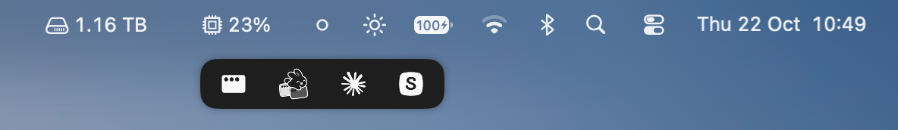</td>
</tr>
</table>

### Notch hub

<table>
<tr>
<td width="50%" valign="top"><b>Overview — the state of every module at a glance</b> 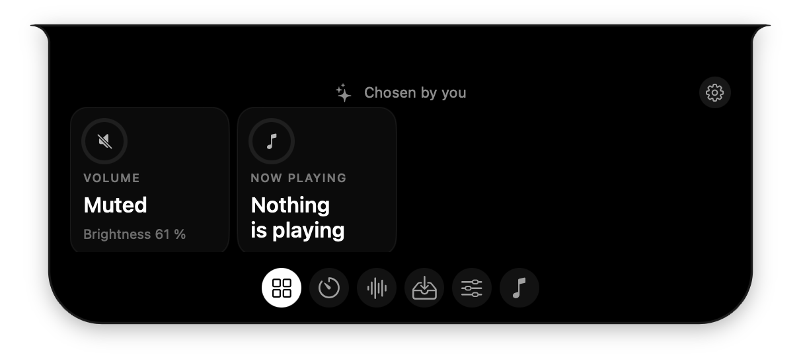</td>
<td width="50%" valign="top"><b>Timers — presets, a length, a time or a stopwatch</b> 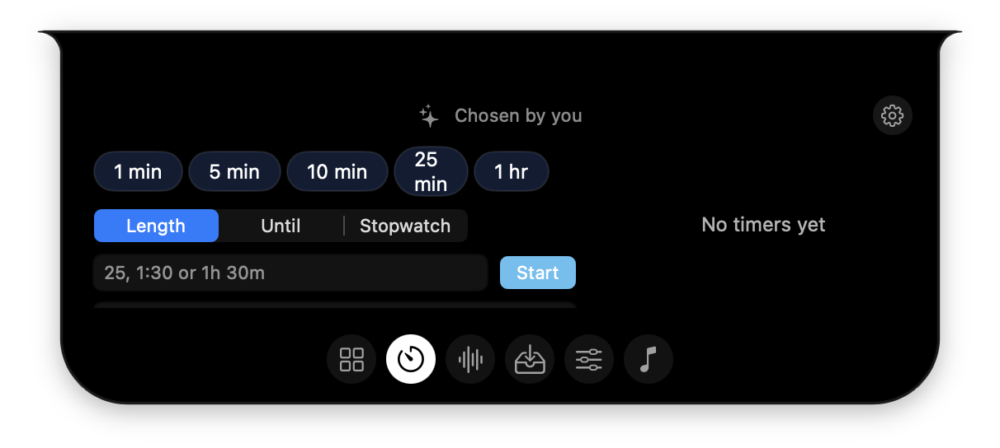</td>
</tr>
<tr>
<td width="50%" valign="top"><b>Display controls — volume, brightness and external monitors</b> 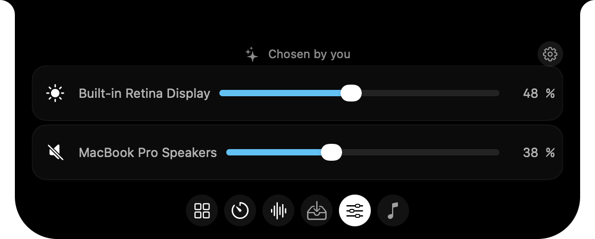</td>
<td width="50%" valign="top"><b>File drop — files kept at the notch</b> 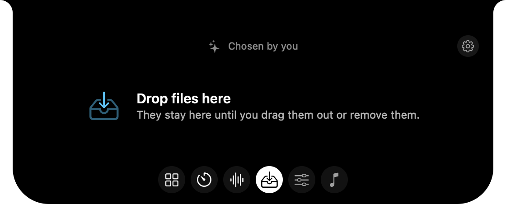</td>
</tr>
</table>

### Settings

<table>
<tr>
<td width="50%" valign="top"><b>Layout — every item in its section, by drag or keyboard</b> 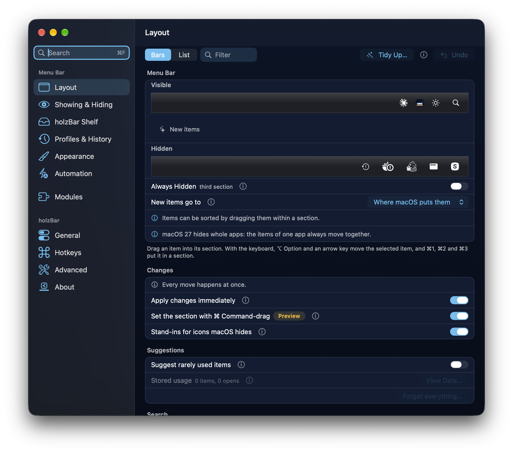</td>
</tr>
<tr>
<td width="50%" valign="top"><b>General — startup and the menu bar icon</b> 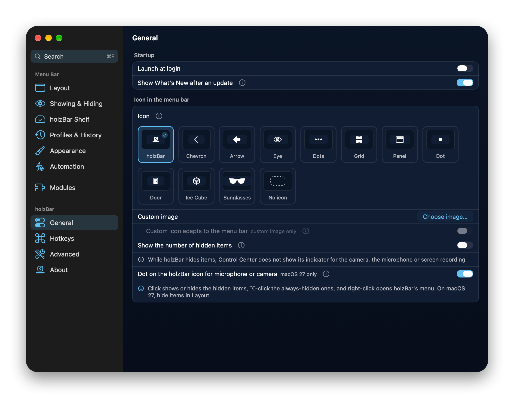</td>
<td width="50%" valign="top"><b>Showing &amp; Hiding — click, hover, scroll, rehide, Zen mode</b> 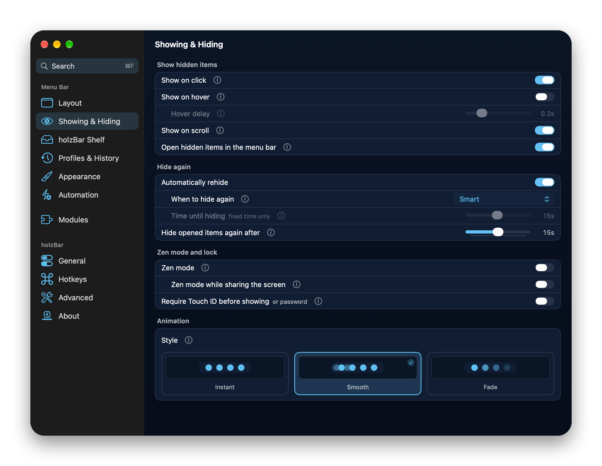</td>
</tr>
<tr>
<td width="50%" valign="top"><b>Appearance — moods, shape, tint, shadow and border</b> 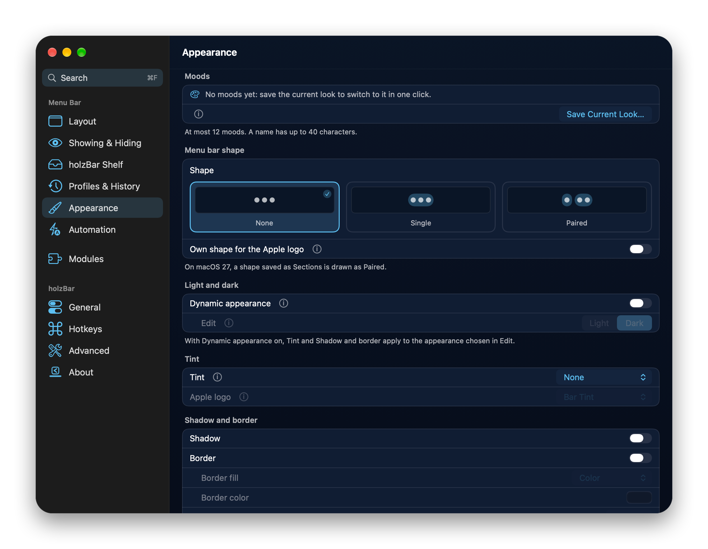</td>
<td width="50%" valign="top"><b>Profiles &amp; History — profiles, groups, spacers, history</b> 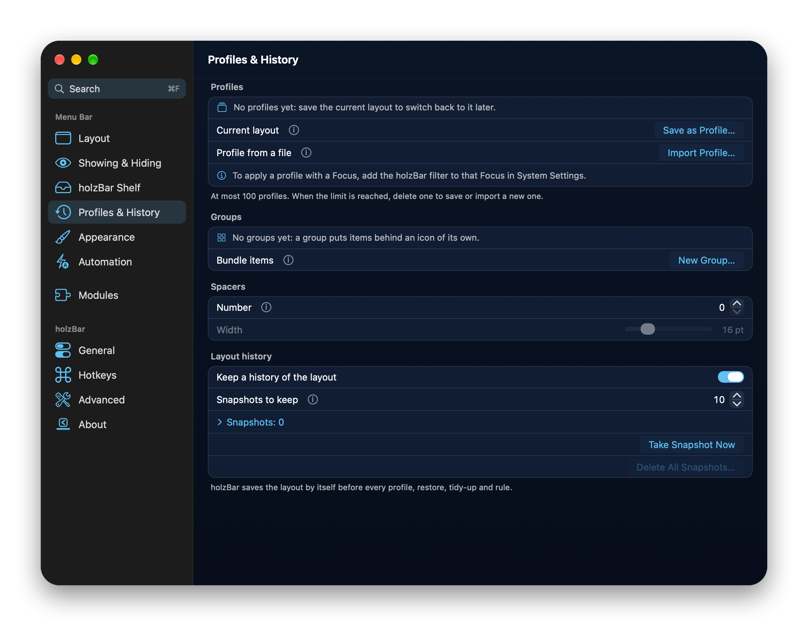</td>
</tr>
<tr>
<td width="50%" valign="top"><b>Automation — rules, scripts and profile hooks</b> 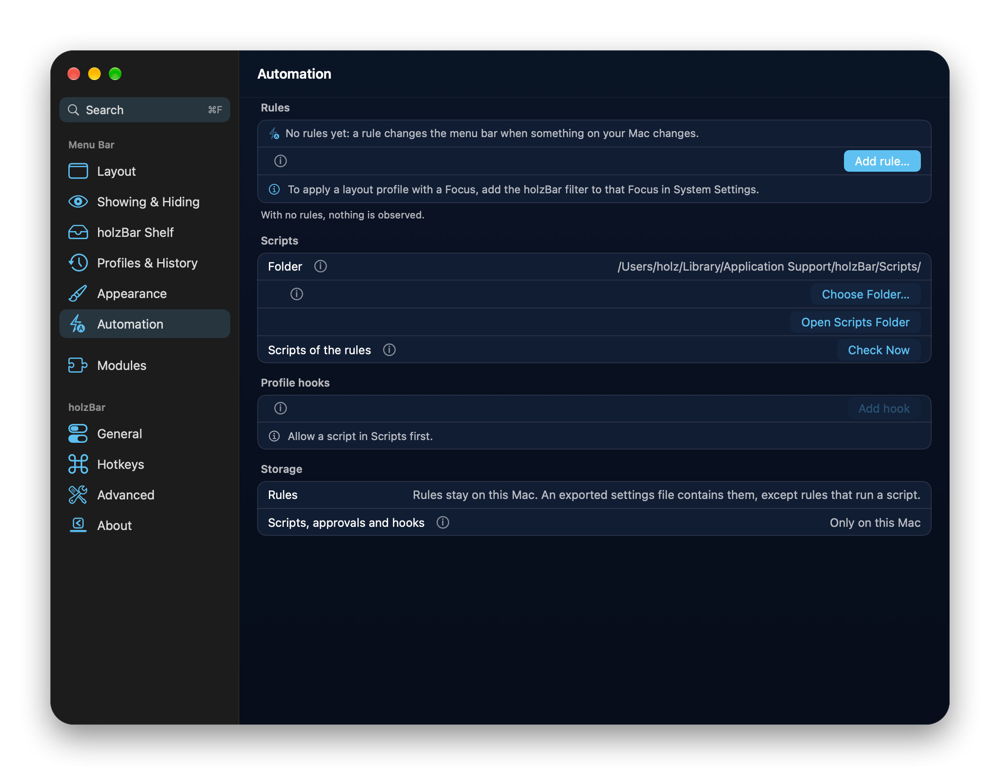</td>
<td width="50%" valign="top"><b>Hotkeys — a shortcut for every frequent action</b> 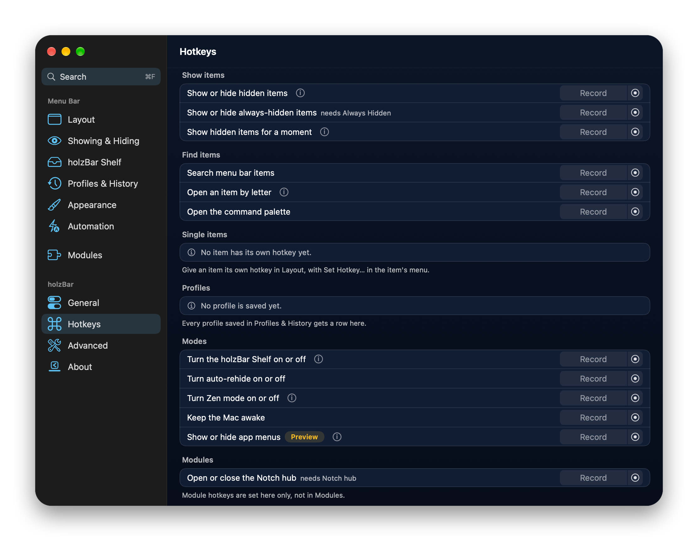</td>
</tr>
<tr>
<td width="50%" valign="top"><b>Modules — every module with its own switch</b> 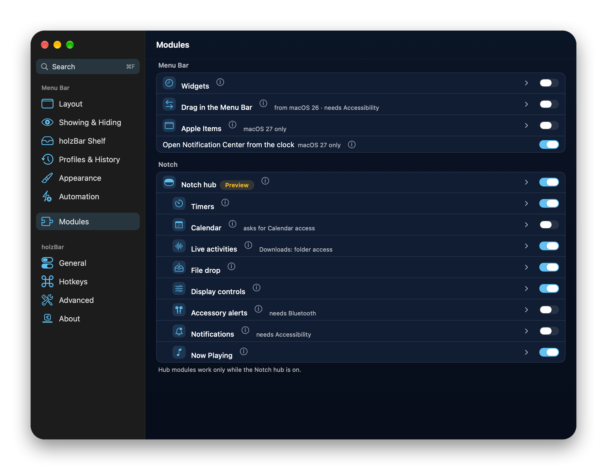</td>
<td width="50%" valign="top"><b>Advanced — right-click, item spacing, backup and permissions</b> 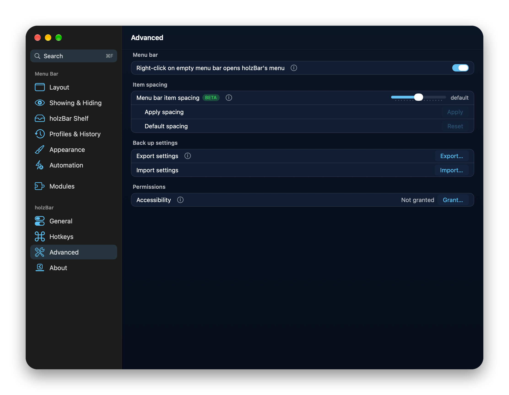</td>
</tr>
</table>
