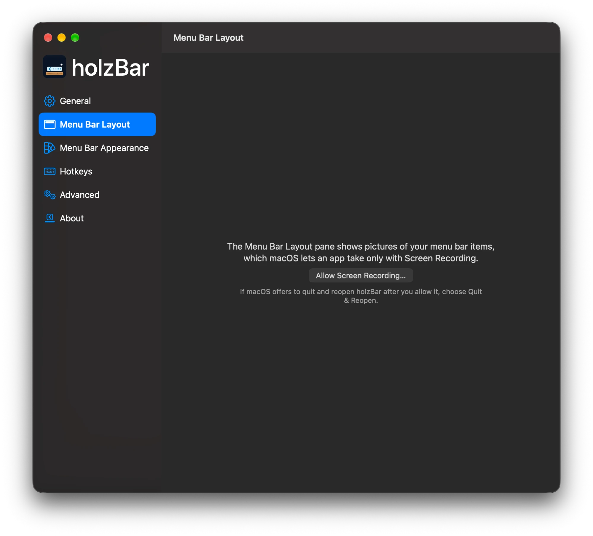

# Privacy and permissions

## Principles

Every change to holzBar follows four rules — without taking a feature away:

- **Modern** — written the way a macOS app is written in 2026: current Swift, Swift concurrency and current SwiftUI and AppKit APIs. Outdated APIs are replaced as the code is touched.
- **Lean and fast** — as little CPU, energy, memory and disk as possible; no polling where macOS sends an event; a small app that launches fast.
- **Private** — holzBar never connects to the network: no telemetry, no analytics, no crash reports, no update checks, no remote content. The only exception is a link you click, which opens in your browser. Your data stays on your Mac and out of the logs; the scripts folder, the approvals and the rules that use a script stay on the Mac in a file only you can read. To show hidden items when the network drops, holzBar only watches whether a network path is available (Apple's NWPathMonitor); it never opens a connection. The `no-network` check fails every pull request that adds networking code or a third-party package, and every build checks the app's binaries and entitlements for network access.
- **Least privilege** — holzBar asks only for the permissions a feature really needs, when it needs them, and says why.

Where holzBar doesn't meet a rule yet, that is a bug to fix.

## Permissions

Everything holzBar asks macOS for, the feature that needs it and when it is asked:

| Permission or entitlement | Needed for | When |
|---|---|---|
| **Accessibility** required | Reading where menu bar items are; moving, showing and clicking them for you; noticing clicks, scrolls and hovers in the menu bar for show on click, scroll and hover; on macOS 27, an Escape key press sent to Notification Center or Control Centre to close a panel holzBar opened; while **Drag in the Menu Bar** is on (macOS 26 and 27; off by default), holding back a left click on an app's menu bar item until it is clear whether you click or drag it, then replaying it (the left mouse button only; no key is read) | Asked on the first launch |
| **Screen Recording** optional | Pictures of menu bar items in the holzBar Shelf, the search and the Menu Bar Layout pane (on macOS 27 taken once per item), and a moving wallpaper beside a menu bar shape (before macOS 27; other wallpapers are read from their file) | Offered, never required: Settings → Advanced and the first-launch Permissions window have Grant and Revoke buttons for it, a window asks once the first time you open the holzBar Shelf (holzBar remembers your answer), and the Menu Bar Layout pane and a menu bar shape with a moving wallpaper offer it where they need it. Without it, everything else works, the holzBar Shelf and the search show app icons, and nothing captures the screen |
| **Login item** | Starting holzBar when you log in | Only when you turn on "Launch at login" |
| **Microphone and camera use** no permission | The dot on holzBar's icon (macOS 27) while another app uses the microphone or a camera, and the automation conditions "camera in use" and "microphone in use" (macOS 14.2 and later). holzBar reads only whether a process records audio (Core Audio) and whether a camera is running (CoreMediaIO), on a background queue; it opens no audio or video, and records and stores nothing | Only while "Show a dot on the holzBar icon…" is on (Settings → General, on by default, macOS 27), or while an enabled rule has one of the two conditions |
| **Accessibility display options** no permission | Reduce Transparency and Increase Contrast: System Glass, the holzBar Shelf and Settings' groups are drawn opaque with a border. Reduce Motion: items in Menu Bar Layout jump instead of sliding. holzBar reads the options from macOS (`NSWorkspace` and the SwiftUI environment) and stores nothing | Only while System Glass is the tint in use or the holzBar Shelf is open (one change notification, no polling), and while a Settings view or Menu Bar Layout shows them |
| **Widgets** no permission | Text of your own in the menu bar from sources that need no permission: the date and time, the battery, CPU load, memory, uptime and free disk space, read from macOS on this Mac only while a widget is visible, never while it is hidden or while the Mac is asleep or locked. Nothing is stored but the list of widgets (each one's source, format and order) and nothing is logged. A Shortcut button's Shortcut name stays on this Mac under a key of its own and is never exported, imported or synced; the button opens the Shortcuts app with that name and nothing else, and no data goes to the Shortcut or comes back. A script widget runs a script you allowed like any other, under the rules of the Scripts row below (only the folder you chose, only the exact content you allowed, no arguments, no shell, the event name `widget-refresh` as its only input, the first line of its output kept in memory and shown as plain text), only while it is visible, on a click and on system events, never on a timer. Which script a widget runs stays on this Mac in the scripts file and is never exported, imported or synced | Only while the Widgets module is on (Settings → Modules; off by default) |
| **Layout snapshots** | Small files in `~/Library/Application Support/holzBar/Snapshots`, readable only by you, with the sections of your menu bar items and applications (bundle identifiers and item names). They are not synced or exported, and "Delete All Snapshots" removes them | On by default; turn it off in Menu Bar Layout |
| **Scripts** | A script you allowed runs as you, with holzBar's permissions (Accessibility, and Screen Recording if you allowed it); macOS asks separately before it controls another app. Whether an allowed script can really use holzBar's own Accessibility and Screen Recording grants has not been measured on a Mac yet, so treat an allowed script as being as powerful as holzBar. holzBar gives a script only the event name (`HOLZBAR_EVENT`, one of six fixed names) and keeps only the first line of its output, in memory. Nothing about scripts, their approvals or the rules that use them is exported, imported or synced, and scripts run only from the folder you chose | Only when you allow a script and a rule, a profile hook or a script widget uses it |
| **Bluetooth** optional | Only for the automation condition "A Bluetooth device is connected": which of your paired devices are connected, read on this Mac. holzBar discovers, pairs with and connects to nothing, and stores only the name you pick in the rule | Asked by macOS the first time you add such a condition |
| **AppleScript** no permission of holzBar | holzBar answers the commands of its dictionary (show, hide, apply a profile, switch rules and Zen mode). macOS asks the calling app (Script Editor, a Shortcut) for permission to control holzBar; holzBar sends no Apple events itself | Only when a script calls holzBar |
| **Usage counters** off by default | One file, `~/Library/Application Support/holzBar/Usage.json`, readable only by you and excluded from backups: how often each visible item was opened per day for 30 days. No times, titles or order. Never exported, synced, logged or put into diagnostics; "View Data" shows it and "Forget Everything" or turning it off deletes it | Only when you turn on usage suggestions |
| **Entitlements** | None, not even `get-task-allow`, which would let a debugger attach. holzBar runs without the App Sandbox, because Accessibility event taps and the menu bar's private WindowServer calls do not work in it, and it has no network entitlement | — |
| **Location Services** | Only for the automation condition "Wi-Fi network named …": since macOS 14 the system gives the network name only to apps that may use Location Services. holzBar reads that name and requests no location updates, and stores no location. Without it the condition is never true | Only when you add that condition: holzBar explains why first, then macOS asks |
| **Info.plist usage strings** | The one for Location Services above. Accessibility and Screen Recording need none | — |
| **Reset and Grant Again** | Runs `tccutil reset` for holzBar's own entry only, when a stale permission keeps the permissions window open | Only when you click it |

holzBar is a single executable with no helper process or other nested code, so no code that ships with it runs with these permissions besides holzBar itself; a script that you allowed is your own code and runs as described in the Scripts row. Accessibility calls into other apps, such as finding the app behind each menu bar item on macOS 26 and registering the observers that notice new and changed items, run off the main thread with time limits, so a slow app does not stall holzBar or your clicks.

Without any permission, holzBar also reads, on your Mac only:

- **Code signatures of running apps** (macOS 26), to tell macOS's own processes from other apps when it works out which app a menu bar item belongs to.

 Screen Recording is asked only when a feature needs it, and holzBar says why.

> [!WARNING]
> **macOS 27: the camera, microphone and screen recording indicator.** While holzBar hides menu bar items on macOS 27, Control Centre does not show its privacy indicator — green for the camera, orange for the microphone, indigo for screen sharing or recording. The small green dot beside the clock still appears while the camera is on. The indicator comes back while holzBar hides no item. holzBar cannot prevent this: macOS removes the indicator whenever an app hides items the way holzBar must on macOS 27. Instead, holzBar puts a dot on its own icon while it hides items and another app uses the microphone (orange) or a camera (green), and shows its icon for that even when "Show holzBar icon" is off. Screen recording is not covered: no public API reports it. The setting is in **Settings → General**, on by default, and needs no permission.
